# GenSynth User Guide

GenSynth is a desktop application that generates synthetic event streams. You describe the devices
you want to simulate (sensors, machines, vehicles…), the values each one reports and how often it
reports them, and GenSynth produces the messages continuously, following a single simulation clock.

Messages are organised in **groups** and **flows**. Their content comes from configurable
**variables** (numbers, texts, lists, booleans, dates and positions), which can follow random,
scripted, periodic or correlated patterns. Each flow delivers its messages to a destination through
a **connector**: GenSynth writes to files out of the box, and connector plugins add other
technologies. Use it whenever you need realistic, repeatable data to develop, test or demonstrate a
system that consumes events.

This guide covers GenSynth **0.5.1**. For a quick overview, see the [README](README.md).

## Contents

1. [Installation](#installation)
2. [Key ideas](#key-ideas)
3. [The workspace](#the-workspace)
4. [Your first simulation](#your-first-simulation)
5. [Groups](#groups)
6. [Flows](#flows)
7. [Connectors](#connectors)
8. [Simulation clock and settings](#simulation-clock-and-settings)
9. [Variables](#variables)
   - [Creating a variable](#creating-a-variable) · [Scopes](#scopes) ·
     [The variable editor](#the-variable-editor)
     ([Inherit from a list](#inherit-value-from-parent-scope-list) ·
     [Conditional rules](#conditional-rules))
   - **[Numeric](#numeric-variables)**: [Random](#random) · [Constant](#constant) ·
     [Sequential](#sequential) · [Distribution](#distribution) · [Formula](#formula) ·
     [Sinusoidal Wave](#sinusoidal-wave) · [Linear Drift](#linear-drift) ·
     [Noise and spikes](#noise-and-spikes)
   - **[String](#string-variables)**: [modes](#string-modes) · [masks](#string-masks) ·
     [data corruption](#string-data-corruption)
   - **[List](#list-variables)**: [strategies](#list-selection-strategies) ·
     [Markov chain](#list-markov-chain)
   - **[Boolean](#boolean-variables)**: [patterns](#boolean-patterns)
   - **[Temporal](#temporal-variables)**: [advance mode](#temporal-advance-mode) ·
     [clock drift](#temporal-clock-drift) · [output format](#temporal-output-format)
   - **[Point](#point-variables)**: [visual editor](#point-visual-editor) ·
     [movement patterns](#point-movement-patterns) · [waypoint editor](#point-waypoint-editor) ·
     [graph route](#point-graph-route) · [spatial boundaries](#point-spatial-boundaries) ·
     [changing the coordinate system](#changing-the-coordinate-system)
10. [Recipes for typical event patterns](#recipes-for-typical-event-patterns)
11. [Saving and loading](#saving-and-loading)
12. [Feedback](#feedback)
13. [Keyboard shortcuts](#keyboard-shortcuts)
14. [Limitations](#limitations)
15. [Troubleshooting](#troubleshooting)

---

## Installation

Download the installer for your system from the
[**latest release**](https://github.com/alegarciasanchez7/tfg-gensynth/releases/latest).
Everything GenSynth needs is included: you do not need to install Java.

| Your system | File | How to install |
|---|---|---|
| Windows 10/11 (64-bit) | `GenSynth-installer-<version>.msi` | Double-click it and follow the steps. GenSynth appears in the Start menu. |
| Ubuntu, Debian, Linux Mint… | `GenSynth-installer-<version>.deb` | Double-click it, or `sudo apt install ./GenSynth-installer-<version>.deb` |
| Fedora, openSUSE, RHEL… | `GenSynth-installer-<version>.rpm` | `sudo dnf install ./GenSynth-installer-<version>.rpm` |
| macOS (Apple Silicon) | `GenSynth-installer-<version>.dmg` | Open it and drag GenSynth into *Applications*. |

> **Important:**
>
> - **Windows:** GenSynth is not signed, so SmartScreen may show *"Windows protected your PC"*.
>   Click **More info → Run anyway**.
> - **macOS:** the first time, right-click GenSynth in *Applications* and choose **Open** (or
>   *System Settings → Privacy & Security → Open Anyway*). The disk image includes a
>   `READ_ME_FIRST.txt` file with these steps.
> - **First start:** GenSynth downloads its embedded browser (about 150 MB), so it needs an
>   internet connection. A window shows the progress; it only happens once.

To update, install the new version over the old one: your plugins and settings are kept.

### Where GenSynth keeps its files

| What | Installed application | Built from source |
|---|---|---|
| Plugins, autosave and embedded browser | Windows: `%LOCALAPPDATA%\GenSynth`<br>Linux: `~/.local/share/gensynth`<br>macOS: `~/Library/Application Support/GenSynth` | `core/` |
| Generated files (`OUTPUT_FILES_<date>`) | `~/GenSynth` (your user folder) | `core/` |

Uninstalling GenSynth does not delete these folders.

### Optional: the RabbitMQ connector

GenSynth always includes the **File Output** connector. To publish to RabbitMQ, also download
`rabbitmq-connector-1.0.0.jar` from the **Assets** of the same release page. You install it from
inside GenSynth (see [Importing a plugin](#importing-a-plugin)); there is nothing to unpack.

---

## Key ideas

| Concept | What it is |
|---|---|
| **Group** | A set of flows that start and stop together and share an output mode (parallel or sequential). Think of it as a site or a fleet. |
| **Flow** | One stream of messages: a message format (template), a pace (*Every N ticks*) and a destination (connector). Think of it as one device. |
| **Variable** | A value generator (number, text, list item, boolean, date/time or position) that you insert in a template with `{{name}}`. |
| **Template** | The text of each message (JSON, XML, CSV or plain text) with `{{…}}` placeholders. |
| **Connector** | Where messages go: a file, or a broker added with a plugin (RabbitMQ…). |
| **Tick** | The global clock of the simulation. On every tick, each flow that is due generates one message. |

---

## The workspace

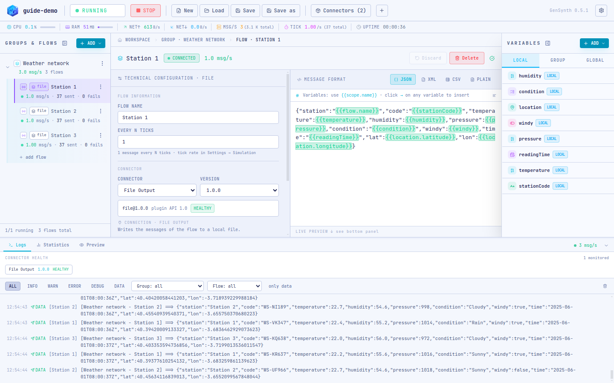

| Area | What you find there |
|---|---|
| **Top bar** | Project name (a `*` means unsaved changes), status (**RUNNING** / **STOPPED**), **START** / **STOP**, **New**, **Load**, **Save**, **Save as**, **Connectors (N)** (catalog), **+** (import a plugin), **Feedback**, the version and the ⚙ **Settings** button. |
| **Resource bar** | Live metrics, see below. |
| **Left panel – GROUPS & FLOWS** | Your groups and the flows inside them. **+ ADD** opens a menu with **Add Group** and **Add Flow**. Each flow shows its live **msg/s**, **sent** (messages delivered), **fails** (messages that could not be generated or sent) and, when above 0, **dropped** in amber (messages lost on purpose by [event loss](#event-loss)), plus chips with the variables its template uses. A locked group shows a lock icon. The footer shows how many groups are running (locked groups never count) and how many are locked. |
| **Center** | The editor of the selected group, flow or variable, with a breadcrumb at the top. |
| **Right panel – VARIABLES** | The variables, split in **LOCAL**, **GROUP** and **GLOBAL** tabs. **+ ADD** creates a variable; the **→** button on a variable inserts it in the template you are editing. |
| **Bottom panel** | **Logs**, **Statistics** and **Preview** of the generated messages. |

Both side panels can be collapsed and resized by dragging their inner edge.

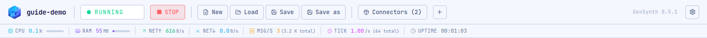

The **resource bar** shows **CPU** and **RAM** used by GenSynth. The CPU bar is the share of the
whole computer (all cores); the RAM bar is the memory in use out of the most GenSynth may use
(by default a quarter of the computer's RAM, e.g. about 2 GB with 8 GB). It also shows **NET↑** /
**NET↓** (bytes per second sent and received), **MSG/S** (messages per second, with the total in brackets),
**TICK** (ticks per second, with the total number of ticks) and **UPTIME** of the current run.

---

## Your first simulation

This walkthrough builds three weather stations that send a JSON reading every second to a file.
It takes about five minutes.

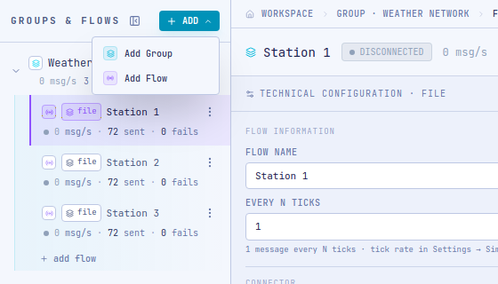

1. **Create a group.** In the left panel click **+ ADD → Add Group**, type the name
   `Weather network` and click **Create group**.

   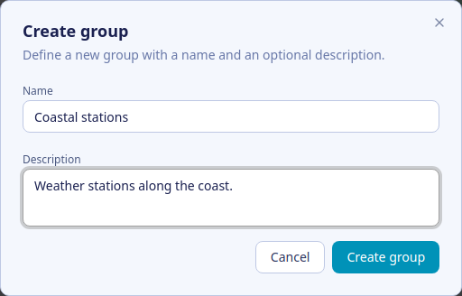

2. **Add a flow.** Click **+ add flow** under the group (or **+ ADD → Add Flow**). Name it
   `Station 1`, keep **Every N ticks** = `1`, choose the connector **File Output** and set
   **File format** to **Text (one message per line)**. Click **Create flow**.

   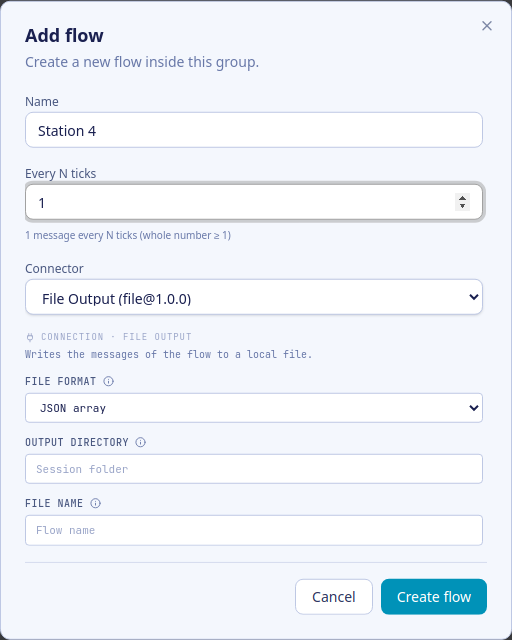

3. **Create the variables of the station.** In the right panel, select the **LOCAL** tab, click
   **+ ADD**, choose the type and fill in the dialog. Set **Target Flow Assignment** to
   *Station 1*. Create:

   | Name | Type | Configuration (Visual Editor) |
   |---|---|---|
   | `temperature` | Numeric | **Minimum** 15, **Maximum** 30, **Decimal Places** 1, pattern **Random** |
   | `humidity` | Numeric | **Minimum** 40, **Maximum** 80, pattern **Distribution → Normal / Gaussian** |
   | `condition` | List | Strategy **Weighted Random**, literal items `Sunny` (weight 5), `Cloudy` (3), `Rain` (1) |
   | `readingTime` | Temporal | **Advance Mode** = **Simulated Step**, **Start Date (ISO)** `2026-01-01T00:00:00Z`, **Step Duration (ms)** `60000`, **Format Preset** `UNIX_TIMESTAMP` |

4. **Write the message format.** Select the flow and type this in **Message Format** (type `{{`
   to get suggestions):

   ```json
   {
     "station": "{{flow.name}}",
     "time": {{readingTime}},
     "temperature": {{temperature}},
     "humidity": {{humidity}},
     "condition": "{{condition}}"
   }
   ```

   `{{flow.name}}` is replaced by the name of the flow, so every station sends its own ID.
   Text values go between quotes; numbers and booleans do not.

5. **Clone the station.** In the left panel open the **⋮** menu of *Station 1* (or the clone
   icon) and choose **Clone flow**. Set **Number of clones** = `2` and **Naming Pattern** =
   `Station ${index+1}`. The live preview shows *Station 2* and *Station 3*. Each clone gets a copy
   of the template, the connector settings and the LOCAL variables, so each station has its own
   generators.

   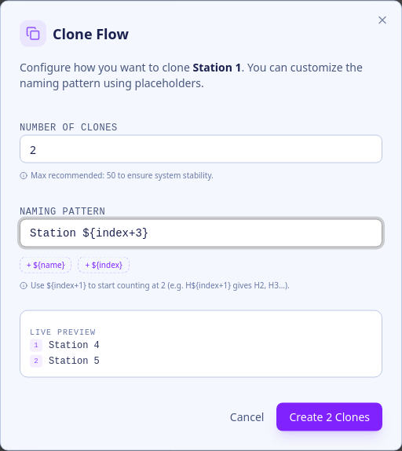

6. **Start.** Click **START** in the top bar. The flows show `1.0 msg/s` and the **sent** counter
   grows.

7. **Watch the data.** Open **Preview** in the bottom panel to see the template and the last
   message of a flow, or **Logs** to see every flow (filter with **only data**).

8. **Stop and find the files.** Click **STOP**. The messages are in
   `~/GenSynth/OUTPUT_FILES_<date>/Weather_network/Station_1.txt` (one file per station).

9. **Save the project.** Click **Save as** and choose a name such as `weather.gsynth`.

### Sending to RabbitMQ

1. **Run a broker.** The quickest way is Docker:

   ```bash
   docker run -d --name rabbitmq -p 5672:5672 -p 15672:15672 rabbitmq:3-management
   ```

2. **Install the plugin.** Click **+** (Import Plugin) in the top bar, drop
   `rabbitmq-connector-1.0.0.jar`, wait for the validation and click **Import Validated Plugin →
   INSTALL & RESTART**. GenSynth restarts (see [Importing a plugin](#importing-a-plugin)).
3. **Point the flows to RabbitMQ.** In each flow, change **Connector** to **RabbitMQ** and fill in
   the fields. For a local broker only three fields need a value:

   | Field | Value |
   |---|---|
   | **Exchange** | `weather` |
   | **Routing key** | `weather.reading` |
   | **Queue (optional)** | `weather-readings` |

   Setting **Queue** makes GenSynth create a durable queue bound to the exchange, so messages are
   kept until your consumer reads them. Tip: configure *Station 1* first and then clone it; clones
   copy the connector settings.
4. **Start** and open the management UI at <http://localhost:15672> (user `guest`, password
   `guest`). In **Queues → weather-readings → Get messages** you can see the JSON of each reading.

All the RabbitMQ fields are described in [RabbitMQ connector](#rabbitmq-connector).

### Consuming the events

- Each JSON key of your template becomes a property of the event in your CEP engine: declare
  the event type (schema) with the same names and types. Keep the types stable: numbers without
  quotes, text between quotes.
- `{{flow.name}}` (or any LOCAL variable) identifies the device, so you can group or partition
  by it.
- For **event time**, do not use `{{ts}}` (the computer's clock). Use a Temporal variable in
  **Simulated Step** mode with the **UNIX_TIMESTAMP** format: it produces epoch milliseconds that
  advance by exactly the step you choose, independently of how fast GenSynth runs. Feed that field
  to the engine as the event timestamp (in Esper, for example, by driving its external clock with
  it). See [Simulated event time](#simulated-event-time).
- RabbitMQ messages are persistent and carry the header `content-type: application/json`.

---

## Groups

A group gathers flows that are started and stopped together. Create one with **+ ADD → Add
Group**: the dialog asks for a **Name** and an optional **Description**.

Click a group to open its workspace:

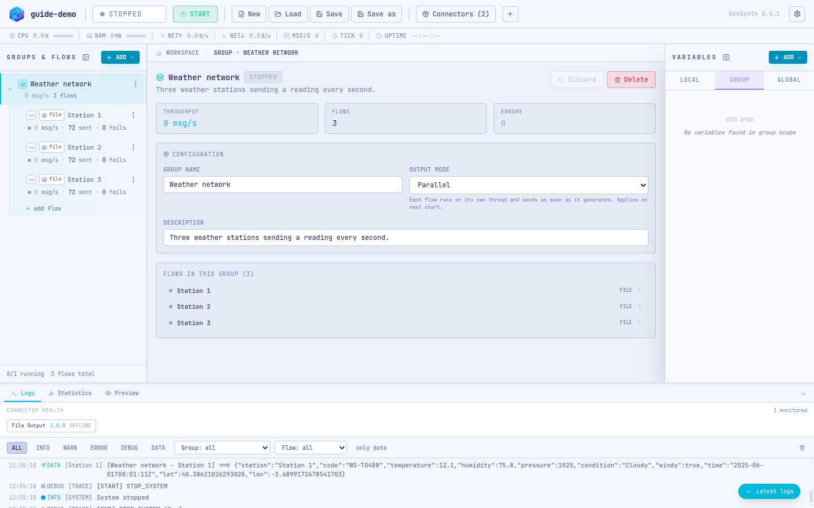

| Element | What it does |
|---|---|
| Status badge | **RUNNING**, **STOPPED** or **PAUSED**. |
| **THROUGHPUT** / **FLOWS** / **ERRORS** | Messages per second of the whole group, number of flows, and flows currently in error. |
| **Group Name** | Name of the group. It is also the sub-folder used by File Output. |
| **Output Mode** | **Parallel** (default) or **Sequential**, see below. Applies the next time the group starts. |
| **Description** | Free text for your own notes. |
| **Flows in this group** | Click a flow to open it. |
| **Discard** / **Delete** | Revert the unsaved changes of the group / delete it with all its flows. |

### Output modes

| Mode | Behaviour | When to use it |
|---|---|---|
| **Parallel** | Each flow has its own sender thread and sends as soon as it generates its message. If a flow is still sending when its next tick arrives, that tick is skipped for that flow (the log warns *"Sending is slower than the tick rate"*). | Independent devices; maximum throughput. |
| **Sequential** | The messages of all flows go into one queue in generation order (tick order, then flow order) and a single sender publishes them one after another. If the queue (10 000 messages) is full, the whole tick is skipped for the group. | When the arrival order at the broker must match the generation order, e.g. to test rules that depend on event order across devices. |

### Group menu (⋮)

| Action | What it does |
|---|---|
| **Lock group** / **Unlock group** | Lock disables every flow of the group: while the simulation runs, they stop generating messages, and the group workspace shows a **LOCKED** badge instead of its run status. A group locked when you click **START** does not open its connectors, so it creates no output file. Unlock enables the flows again, even while the simulation runs. Useful to silence a site without deleting it. |
| **Clone group** | Creates copies of the group with all its flows (same flow names and settings, event loss included), their LOCAL variables and the GROUP variables. The group names follow a [naming pattern](#naming-patterns). |
| **Repeater** | Creates several new flows at once in this group, see below. |
| **Delete group** | Deletes the group and its flows (also available with right-click). |

### Repeater

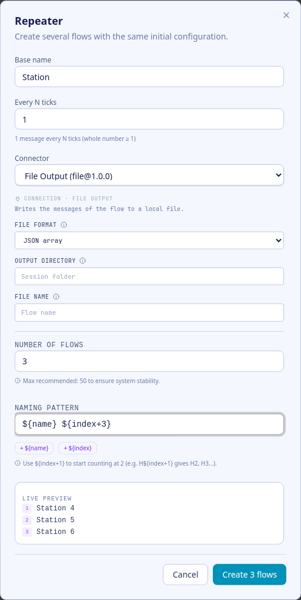

The Repeater is the **Add flow** dialog with a quantity: it creates **Number of flows** flows
named with a **Naming Pattern** from a **Base name**, all with the same **Every N ticks** and
connector settings. The new flows start with an empty template (`{}`) and no variables.

> **Tip:** to create many identical devices, it is usually faster to configure one flow
> completely (template, connector, LOCAL variables) and then use **Clone flow**, which copies
> everything.

### Naming patterns

Clone and Repeater name the new items with a pattern:

| Token | Replaced by | Example (base name `Station 1`, 3 copies) |
|---|---|---|
| `${name}` | The original or base name | `${name} copy` → *Station 1 copy*, *Station 1 copy (2)*, *Station 1 copy (3)* |
| `${index}` | The position of the copy: 1, 2, 3… | `Station ${index}` → *Station 1, Station 2, Station 3* |
| `${index+K}` / `${index-K}` | The position shifted by K | `Station ${index+1}` → *Station 2, Station 3, Station 4* |

The default clone pattern is `${name} (Clone ${index})`; the Repeater default is
`${name} ${index}`. Click **+ ${name}** / **+ ${index}** to append a token, and check the
**Live Preview** before confirming. You can create 1 to 50 copies at a time.

Names must be unique: two flows of the same group, or two groups, cannot share a name (spaces at
the ends and upper/lower case are ignored). When a generated name is already taken, ` (2)`,
` (3)`… is added with the first free number, and the **Live Preview** shows the final names.

---

## Flows

### Creating a flow

Use **+ add flow** under a group, **+ ADD → Add Flow** or the Repeater.

| Field | What it does | Default / range |
|---|---|---|
| **Group** | Group of the flow (only shown when no group is selected). | — |
| **Name** | Name of the flow; available in templates as `{{flow.name}}`. It must be unique in its group (spaces at the ends and case are ignored): a duplicate is reported and the flow cannot be created. The same name can be used in another group. | Required |
| **Every N ticks** | The flow sends one message every N ticks of the global clock. | 1 (whole number ≥ 1) |
| **Connector** | Destination of the messages. Its fields appear below it. | Required |

The flow cannot be created until every required connector field (marked with **\***) is valid.

### The flow workspace

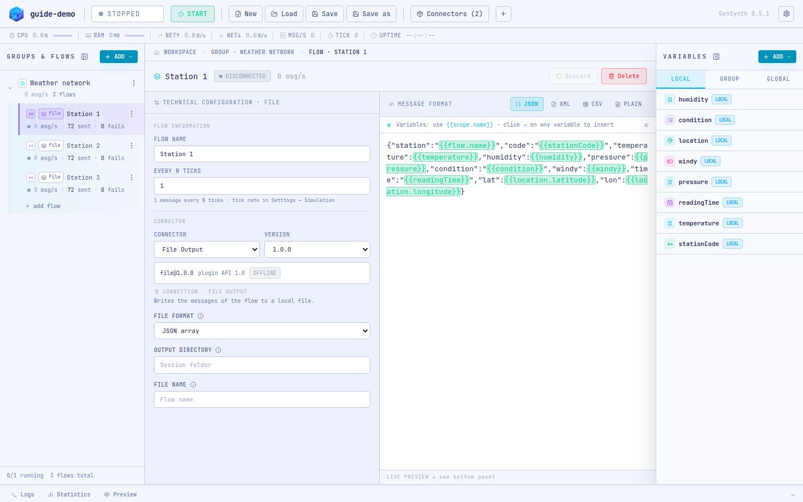

- **Header:** name, connection status (**CONNECTED**, **DISCONNECTED**, **ERROR**, **WARNING**),
  live msg/s, the last error message if any, **Discard** and **Delete**.
- **Technical Configuration:** **Flow Name**, **Every N ticks**, **Connector**, **Version** (when
  several versions of a plugin are installed), a line with the plugin id, its plugin API version
  and its health, the connector fields and the **EVENT LOSS** section (see
  [Event loss](#event-loss)).
- **Message Format:** the template editor, with the **JSON / XML / CSV / PLAIN** buttons.

In the left panel, the **⋮** menu of a flow offers **Lock flow** / **Unlock flow**, **Clone flow**
(copies the template, the connector settings, *Every N ticks*, the event loss and the LOCAL
variables) and **Delete flow**. A locked flow generates nothing and opens no connector, so it
never takes the output file of another flow; unlocking it while the simulation runs makes it start
sending.

Changes to the template, to *Every N ticks* and to the event loss of a running flow apply live.
Changes to the connector or its fields take effect the next time you click **START**.

### Writing the template

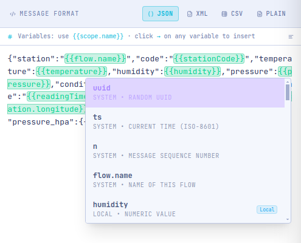

The template is the exact text of each message. Every `{{…}}` placeholder is replaced when the
message is generated; everything else is copied as is.

- Type `{{` to open the autocomplete: it lists the built-ins, the variables the flow can reach
  and their sub-properties, filtered by what you type after `{{` (names that start with it come
  first). Use the arrow keys and **Enter** or **Tab** to insert.
- Placeholders are highlighted: green when valid, red when the variable does not exist or is not
  reachable from this flow.
- **Tab** outside the autocomplete inserts two spaces.

**Built-in placeholders**

| Placeholder | Value |
|---|---|
| `{{uuid}}` | A random UUID, new for every message. |
| `{{ts}}` | The computer's current time in ISO-8601, UTC (e.g. `2026-10-17T09:15:30.123Z`). |
| `{{n}}` | A message sequence number shared by all flows (unique across flows). It starts at 1 when GenSynth opens and keeps counting across STOP/START. |
| `{{flow.name}}` | The name of the flow that renders the template. |

**Referring to variables**

| Syntax | Meaning |
|---|---|
| `{{temperature}}` | The variable `temperature` reachable from this flow. If several share the name, the closest scope wins: LOCAL, then GROUP, then GLOBAL. |
| `{{local.temperature}}`, `{{group.temperature}}`, `{{global.temperature}}` | Force a scope. The autocomplete inserts this form. |
| `{{temperature.round}}`, `{{readingTime.hour}}`… | A sub-property of the value (see the table below). |

Rules worth remembering:

- **One value per variable per message.** If a variable appears twice in a template, or is used
  by a formula or a conditional rule of another variable, all of them see the same value in that
  message. The next message gets a new value.
- A placeholder whose variable cannot be found is left in the message unchanged (e.g.
  `{{tempreature}}`), which makes typos easy to spot in the Preview.
- Values are inserted as plain text, without quotes. In JSON, put text, dates and list items
  between quotes (`"{{condition}}"`) and leave numbers, booleans and UNIX timestamps without them.

**How each type is written**

| Type | Inserted as |
|---|---|
| Numeric | The number (`23.4`, `17`). With prefix, suffix or padding it becomes text (`023 kg`) and needs quotes in JSON. |
| String | The text. |
| List | The selected item; with **Fixed Subset** a JSON array such as `["a", 2]`. |
| Boolean | `true` / `false`. |
| Temporal | The formatted date; with `UNIX_TIMESTAMP`, epoch milliseconds. |
| Point | A JSON object such as `{"x": 12.5, "y": 40.1}` (use sub-properties to get single coordinates). |

Points and **Fixed Subset** lists follow the format of the template:

- **JSON laid out on several lines** (one field per line): the object or array is written on
  several lines too, with the indentation of the template. A one-line template keeps it on one
  line.
- **XML**: as child elements, e.g. `<posicion>{{local.puntito}}</posicion>` gives
  `<posicion><x>12.5</x><y>40.1</y></posicion>` (list items as `<item>` elements), on several
  lines when the template is.
- **CSV**: in one quoted cell (`"{""x"": 12.5, ""y"": 40.1}"`), so its commas do not split the
  row. Use the sub-properties (`{{local.puntito.x}}`) for one column per coordinate.

The DATA logs and the Preview show messages with their line breaks.

**Sub-properties by type** (names are case-insensitive)

| Type | Sub-properties |
|---|---|
| Numeric | `.integerPart` (`.int`), `.decimalPart` (`.fraction`), `.abs`, `.round`, `.floor`, `.ceil`, `.sign` |
| String | `.length` (`.size`), `.upper`, `.lower`, `.trim`, `.firstChar`, `.lastChar` |
| Boolean | `.inverse` (`.not`), `.asNumber` (`1`/`0`), `.asString`, `.upper` (`TRUE`/`FALSE`) |
| Temporal | `.year`, `.monthNumber`, `.monthText` (`January`), `.monthShort` (`Jan`), `.day`, `.dayOfWeek` (`Monday`), `.dayOfWeekNumber` (1–7), `.hour`, `.minute`, `.second`, `.timestamp` (epoch ms), `.timezone` |
| List | `.size`, `.first`, `.last` with every strategy: with **Fixed Subset** they describe the subset; with the strategies that pick one item, `.size` is 1 and `.first` / `.last` are that item. `.item0`, `.item1`… (0-based) only with **Fixed Subset**. |
| Point | `.x`, `.y`, `.z` (Cartesian); `.latitude`, `.longitude`, `.altitude`, `.altitudeUnit`, `.altitudeReference`, and `.latitudeDecimal` / `.longitudeDecimal` in DMS format (Geospatial); `.nodeName`, `.nodeId`, `.targetNodeName`, `.targetNodeId`, `.isPaused` (Graph Route) |

Temporal sub-properties use the instant the variable generated for this message, whatever its
output format, so `{{readingTime}}` and `{{readingTime.hour}}` always describe the same moment.
Hours, days and months are given in the variable's **Time Zone**, or in the computer's zone when
it is empty (the same zone used to format the value).

The autocomplete offers the List sub-properties only for **Fixed Subset** lists (a list without a
strategy counts as Weighted Random), and `.item0`, `.item1`… on any other list are highlighted in
red.

### Converting the format

The highlighted button is the format of the template, detected from its text. Click **JSON**,
**XML**, **CSV** or **PLAIN** above the editor to open **Convert Message Format**. It shows the
**Source Format** (current), lets you pick the **Target Format** and previews the result before
you apply it. When the template is already valid in the target format, only the label changes.
Otherwise the conversion rewrites the template text:

- From JSON, placeholders may be quoted or not (`"t": {{temp}}`). JSON with nested objects or
  lists cannot become CSV: the dialog says which field to flatten.
- From CSV, the first line is the header; text without data rows is converted as plain text.
- From XML, each child element becomes a field (repeated elements become a list). XML with
  attributes, comments or text mixed with elements is not converted, so nothing is lost.
- Plain text becomes a single `message` field.
- The result must be valid in the target format; otherwise the dialog explains why and **Apply**
  stays disabled. JSON or XML content always keeps its label, so it is not converted to **PLAIN**.
- Converting CSV or XML to JSON writes the placeholders between quotes, so a number arrives as
  text; remove the quotes of numeric placeholders afterwards if needed.

The selected format is only a label for the editor: GenSynth sends exactly the text of the
template, whatever button is highlighted.

### Event loss

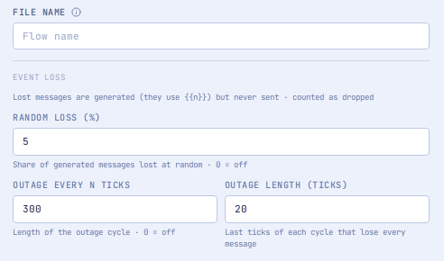

The **EVENT LOSS** section, after the connector fields of the **Technical Configuration** column,
makes a flow lose some of its messages on purpose, to test how your consumer copes with missing
events. Lost messages are generated but never sent, and they count as **dropped** (not as sent nor
as fails).

| Field | What it does | Default |
|---|---|---|
| **Random loss (%)** | Share of the generated messages lost at random (0–100, decimals allowed). | 0 (off) |
| **Outage every N ticks** | Length of the outage cycle, in ticks. | 0 (off) |
| **Outage length (ticks)** | The last ticks of each cycle lose every message. | 0 |

How outages work:

- Ticks are counted from the start of the group (tick 0), and the outage is the last *length*
  ticks of each cycle (at most the whole cycle). With **Outage every N ticks** `4` and **Outage
  length** `2`, the messages of ticks 2, 3, 6, 7, 10, 11… are lost.
- The cycle counts simulation ticks, not messages of the flow: with *Every N ticks* = 3, only the
  messages that fall on outage ticks are lost.
- Outside an outage, each message is lost with the **Random loss (%)** probability.
- When the length is equal to or greater than the cycle, an amber warning says that every message
  of the flow is lost.
- **START**, and resuming a paused group, restart the cycle at tick 0.

Good to know:

- The fields are applied when you leave them or press `Enter`; a running flow uses them from the
  next tick. They mark the flow as unsaved (`*`), **Discard** reverts them and they are saved in
  the `.gsynth` file.
- **Clone flow** and **Clone group** copy them. The **Add flow** dialog does not show them: new
  flows start without loss.
- Lost messages still use `{{n}}` and advance the variables of the message, so a LOCAL counter
  shows gaps where messages were lost (see
  [Missing events](#missing-events-lost-messages-and-outages)).
- The **dropped** counter is kept on pause and on stop, and resets when the group starts again from
  stopped, like the other counters.

### Preview, logs and statistics

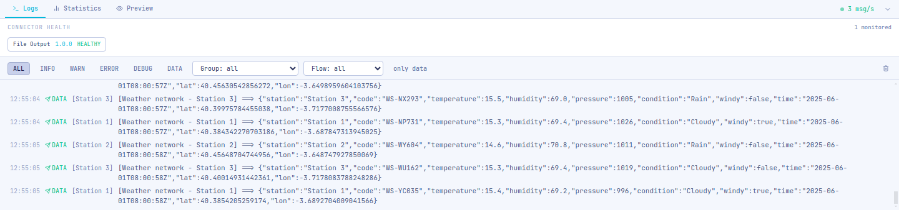

- **Logs:** messages from GenSynth and from the flows. Filter by level (**ALL**, **INFO**,
  **WARN**, **ERROR**, **DEBUG**, **DATA**), by **Group** and by **Flow**; **only data** shows just
  the generated messages. The trash icon clears the list, and **Connector Health** at the top shows
  the state of each connector. To keep the interface fluid, each flow logs at most about four
  messages per second, cut to 250 characters; the destination still receives every message.

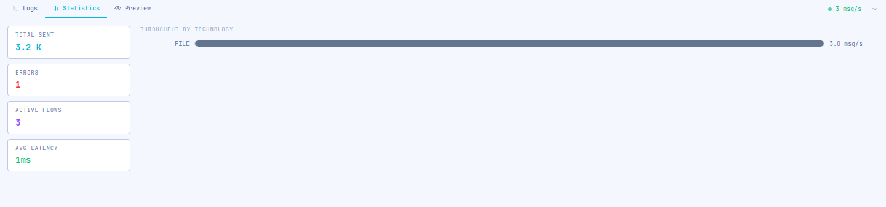

- **Statistics:** **TOTAL SENT** and **ERRORS** (kept after **STOP**, until GenSynth is closed;
  ERRORS also counts connector and command errors, so it can be higher than the sum of the flows'
  fails), **DROPPED** (messages of all flows lost on purpose by [event loss](#event-loss); 0 while
  not running), **ACTIVE FLOWS**, **AVG LATENCY** (time the connector takes to confirm a message)
  and the throughput by technology.

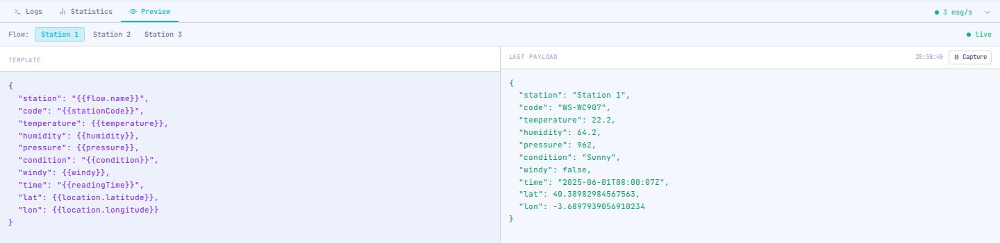

- **Preview:** choose a **Flow** to see its **Template** next to the **Last Payload** it sent. The
  last message stays visible after the simulation stops. **Capture** keeps the message on screen
  (**Captured Payload**) to read it in detail while new ones arrive; **Live** goes back to the
  last message. Each flow keeps its own capture.

**Counters:** a message is **sent** when the connector confirms it (for RabbitMQ, when the broker
acknowledges it); it is a **fail** when it cannot be generated (for example an invalid variable)
or the destination rejects it; it is **dropped** when it is generated but lost on purpose by
[event loss](#event-loss). The logs explain each failure. Every generated message is sent, a fail,
dropped or still pending: generated = sent + fails + dropped + pending.

---

## Connectors

The connector of a flow decides where its messages go. Each connector shows its own fields; hover
the **ⓘ** icon next to a field to see what it means. Fields marked with **\*** are required, and a
flow cannot be created until they are filled in. Password fields have an eye icon to show the
value, and folder fields a **Browse** button.

A message only counts as **sent** when the connector confirms that it was delivered; otherwise it
counts as a **fail**.

### File Output (built in)

GenSynth includes one connector, always available, that writes the messages of each flow to a file:

| Field | What it does | Default |
|---|---|---|
| **File format** | *JSON array*, *Text* (one message per line), *XML dataset* or *CSV* (one message per line). | JSON array |
| **Output directory** | Optional. When empty, files go to the folder of the current session, `OUTPUT_FILES_<date>/` (see [Where GenSynth keeps its files](#where-gensynth-keeps-its-files)). A sub-folder with the group name is always added. | Session folder |
| **File name** | Optional. When empty, the flow name is used. The extension is added automatically. | Flow name |

For example, with the Text format a flow *Sensor 1* in group *Plant A* writes to
`~/GenSynth/OUTPUT_FILES_<date>/Plant_A/Sensor_1.txt` (characters other than letters, digits, `.`,
`_` and `-` become `_`).

Good to know:

- Every **START** creates a new session folder, so each run has its own files.
- Two flows cannot write to the same file at once. Names that turn into the same file name
  (*Sensor 1* and *Sensor_1*), two flows with the same **File name**, or groups that map to the
  same folder (*Plant A* and *Plant_A*) make the second flow fail to start with *File "…" is
  already used by another flow*; give it a different name or **File name**.
- With *JSON array* the `[` … `]` is closed when you click **STOP**. If you set an **Output
  directory**, a new run appends a second array to the same file; use *Text* if you want a file
  you can keep appending to (one JSON object per line).
- *CSV* writes each message as one line and adds no header: write the header yourself if your
  tool needs one.

### Connector catalog

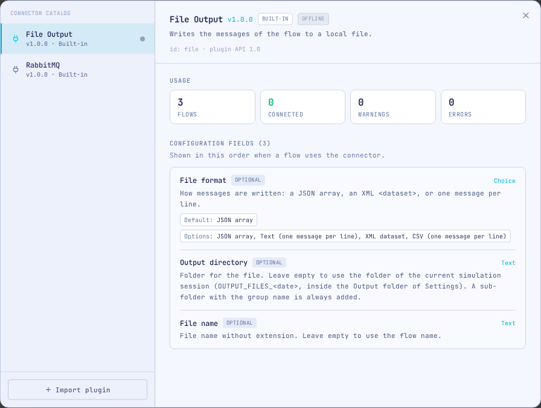

Click **Connectors (N)** in the top bar to open the catalog. For each loaded connector it shows:

- its name, version, description and health;
- **Usage:** how many running **Flows** use it and how many are **Connected**, have **Warnings**
  or **Errors**;
- **Configuration fields:** each field, whether it is **Required** or **Optional**, its
  **Default**, its **Range** and its **Options**, in the order a flow shows them;
- **Uninstall** (installed plugins only): removes the plugin and restarts GenSynth. Flows that
  used it will need another connector.

**Import plugin** is also available from the catalog.

### Importing a plugin

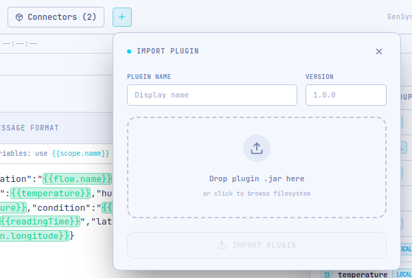

Any destination other than a file is added with a **connector plugin**: a single `.jar` file that
teaches GenSynth to send messages to a technology such as a message broker (AMQP, MQTT, Kafka…),
a TCP/UDP socket or an HTTP endpoint. Plugins are distributed separately from GenSynth, and anyone
can implement one by following the [Plugin Developer Guide](plugin-api/PLUGIN_DEVELOPER_GUIDE.md).

1. Click **+** (Import Plugin) in the top bar, or **Import plugin** in the catalog.
2. Drop the `.jar` file on the panel, or click it to browse your disk. **Plugin Name** and
   **Version** are filled in from the file.
3. GenSynth validates the plugin; the **Validation Logs** show each check.
4. Click **Import Validated Plugin** and confirm with **INSTALL & RESTART**. GenSynth restarts
   (running flows stop) and the new connector appears in the connector list of every flow.

### RabbitMQ connector

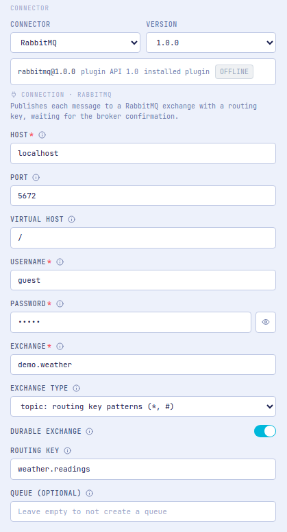

The RabbitMQ plugin publishes each message to an exchange and waits for the broker's
confirmation before counting it as sent.

| Field | What it does | Default |
|---|---|---|
| **Host** \* | Host name or IP address of the broker. | `localhost` |
| **Port** | AMQP port of the broker (TLS is not supported). | `5672` (1–65535) |
| **Virtual host** | Virtual host to connect to. Use `/` unless your broker separates environments with vhosts. | `/` |
| **Username** \* | Broker user. The default `guest` user can only connect from `localhost`. | `guest` |
| **Password** \* | Password of the user. | `guest` |
| **Exchange** \* | Exchange that receives the messages. It is created if it does not exist. | — |
| **Exchange type** | `topic` (routing key patterns with `*` and `#`), `direct` (exact routing key), `fanout` (every bound queue, key ignored) or `headers`. Must match the type of an existing exchange. | `topic` |
| **Durable exchange** | Declares the exchange as durable so it survives a broker restart. Must match an existing exchange. | Yes |
| **Routing key** | Routing key of every message of this flow. Required for `topic` and `direct`; ignored by `fanout` and `headers`. | — |
| **Queue (optional)** | If set, a durable queue with this name is created and bound to the exchange with the routing key, so messages are kept until someone reads them. | Empty |

Good to know:

- Messages are persistent and carry the header `content-type: application/json`.
- A message that reaches no queue (no queue bound with a matching key) is returned by the broker
  and counted as a **fail** with the log *"Message not routed to any queue"*. Fill in **Queue
  (optional)** or bind a queue before starting.
- The routing key is fixed per flow. Use different keys per flow (for example
  `weather.station1`) if your consumer needs to tell streams apart by key, or simply put the
  device ID in the message with `{{flow.name}}`.

---

## Simulation clock and settings

### Ticks

All flows follow one global clock, the **tick**, configured in **Settings → Simulation**:

- **Fixed period:** one tick every N **Milliseconds**, **Seconds** or **Minutes** (default: 1
  second; at most 24 hours).
- **As Fast As You Can:** the next tick starts as soon as the previous one finishes, with no
  wait. Use it to measure the maximum throughput; it may keep a CPU core busy while running.

Each flow sends **one message every N ticks** (its *Every N ticks*). For example, with a tick of
1 second, a flow set to *Every 5 ticks* sends one message every 5 seconds. A flow always sends on
the first tick after START. Changing the tick applies immediately, even while the simulation is
running. While running, the settings show the measured tick rate.

> **Important:** variables do not look at the global tick. They advance **once per value they
> generate**, that is, once per message that uses them. A Sinusoidal, Drift, Sequential, Boolean
> duty cycle or Simulated Step variable used by a flow with *Every 5 ticks* advances one step every
> 5 ticks. A GROUP or GLOBAL variable used by three flows advances three steps per tick (see
> [Scopes](#scopes)).

### Settings

Open them with the ⚙ icon in the top bar. Each category says whether its settings are *Stored on
this device* or *Saved with the project*.

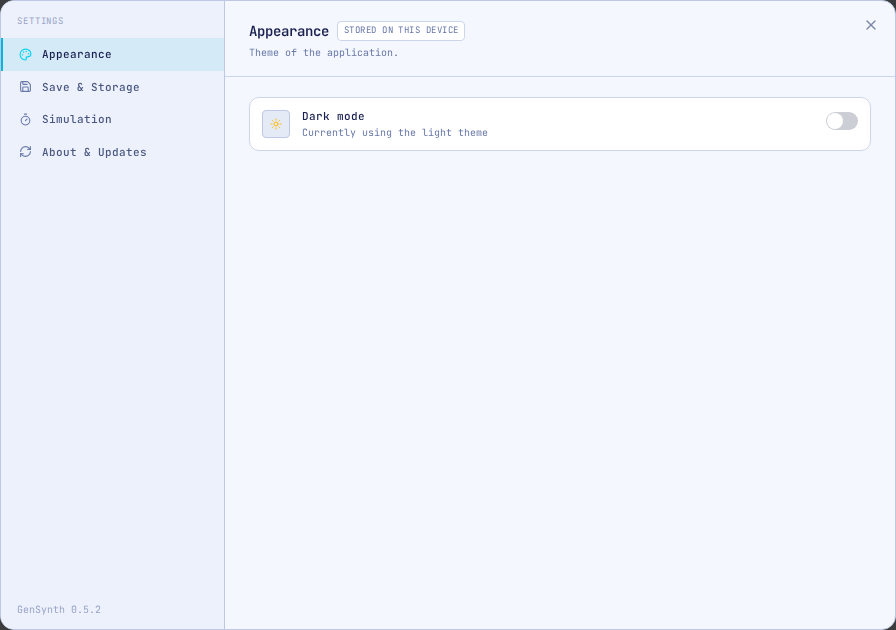

| Category | Setting | What it does | Default |
|---|---|---|---|
| **Appearance** (device) | **Dark mode** | Light or dark theme. | Light |
| **Save & Storage** (device) | **Auto-save** | Saves the open project file automatically while there are changes. It starts working once the project has been saved to a file. | Off |
| | **Interval (seconds)** | Time between automatic saves. | 30 (5–3600) |
| **Simulation** (project) | **Tick mode** | **Fixed period** or **As Fast As You Can**. | Fixed period |
| | Period value and unit | Length of a tick. | 1 Seconds |

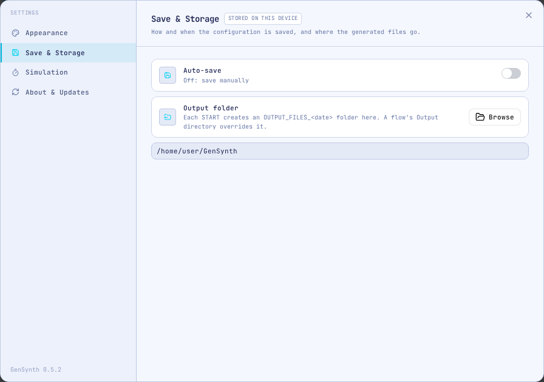

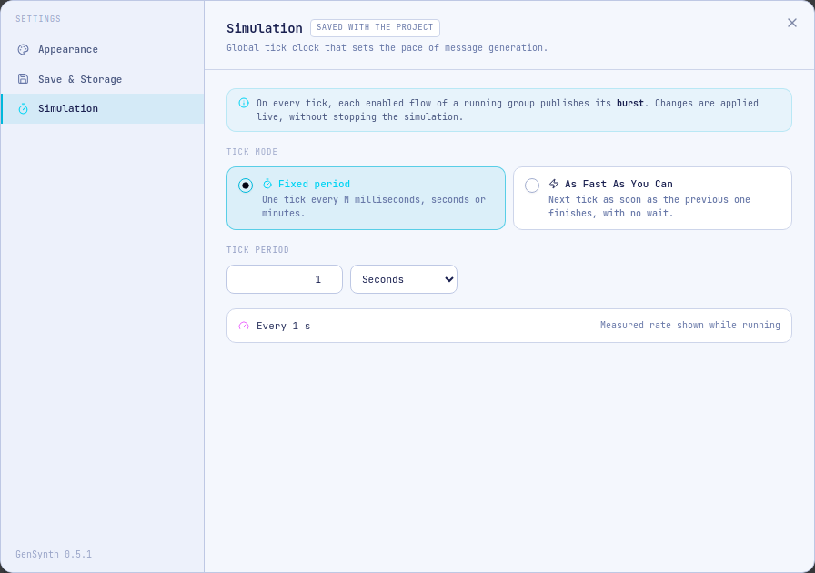

---

## Variables

Variables generate the values of your messages. GenSynth has six types:

| Type | Use it for | Patterns / modes |
|---|---|---|
| [Numeric](#numeric-variables) | Measurements and counters: temperature, speed, load, battery level. | Random, Constant, Sequential, Distribution, Formula, Sinusoidal Wave, Linear Drift; optional noise and spikes. |
| [String](#string-variables) | Identifiers, serial numbers, status texts, malformed data. | Random, Regex, Fixed, Template, Mask/IoT; optional data corruption. |
| [List](#list-variables) | Categories, exact scripted sequences, state machines, arrays of values. | Weighted Random, Sequential, Shuffle, Markov Chain, Fixed Subset. |
| [Boolean](#boolean-variables) | Flags and ON/OFF states: doors, motors, alarms. | Constant State, Probability Ratio, Flip Interval, Burst Mode, Markov Chain, Duty Cycle, Alternating Toggles. |
| [Temporal](#temporal-variables) | Timestamps and simulated event time. | Wall Clock, Simulated Step, Backfill Historical, Fixed; optional clock drift. |
| [Point](#point-variables) | Positions on a plane, in space or on a map. | Fixed Point, Random Point, Random Walk, Circular Orbit / Spiral, Waypoint Navigation, Graph Route. |

**In this chapter:**

- [Creating a variable](#creating-a-variable), [Scopes](#scopes) and
  [The variable editor](#the-variable-editor) apply to every type, including
  [inheriting a value from a list](#inherit-value-from-parent-scope-list) and
  [conditional rules](#conditional-rules).
- Then one section per type, linked from the table above, with its fields, patterns and typical
  uses.

### Creating a variable

In the right panel, choose the scope tab, click **+ ADD** and pick the type.

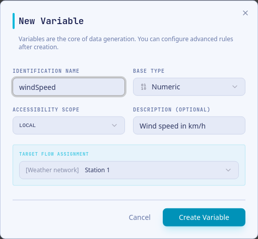

| Field | What it does |
|---|---|
| **Identification Name** | The name you use in templates (`{{name}}`). It must be unique in its place (flow, group or globally); GenSynth reports a duplicate name before you create the variable. In the variable editor, an empty or taken name is not applied: a warning appears and the variable keeps its previous name until you type a free one. |
| **Base Type** | Numeric, String, List, Temporal, Point or Boolean. |
| **Accessibility Scope** | LOCAL, GROUP or GLOBAL (see below). |
| **Description (Optional)** | A note for yourself (not saved in the project file). |
| **Target Flow Assignment** / **Target Group Assignment** | The flow (LOCAL) or group (GROUP) the variable belongs to. |

> **Tip:** use names made of letters, digits and underscores (`wind_speed`, `windSpeed`). Dots
> break template references, and spaces or hyphens break formulas. Do not use the names `uuid`,
> `ts` or `n`: the built-ins take precedence.

### Scopes

| Scope | Reachable from | Use it for |
|---|---|---|
| **LOCAL** | Only its flow. Copied when the flow is cloned. | Anything that belongs to one device: its sensors, its state, its clock. |
| **GROUP** | Every flow of its group. Copied when the group is cloned. | A value that the whole group must share in the same instant, such as a common setting. |
| **GLOBAL** | Every flow. | Shared values and the lists that other variables inherit from. |

> **Important:** a GROUP or GLOBAL variable is **one single generator shared by every flow that
> uses it**. Each use takes the next value: if three stations use a GROUP `temperature`, they
> receive three different consecutive values, and a sequence or a drift advances three steps per
> tick. To give each device its own sensor, create LOCAL variables (or configure one flow and clone
> it).

When names clash, the closest scope wins: LOCAL, then GROUP, then GLOBAL. Use the
`{{local.…}}` / `{{group.…}}` / `{{global.…}}` form to be explicit.

### The variable editor

Click a variable in the right panel to open it.

- **Identity:** **Name**, **Scope**, **Target Flow** / **Target Group** and **Description**. You can
  move a variable to another scope or flow here.
- **Configuration:** the **Visual Editor** tab (fields of the type), the **Rules** tab
  ([conditional rules](#conditional-rules)) and, for Point variables, **Spatial Boundaries**.
- **Discard** reverts the unsaved changes of the variable; **Delete** removes it.

Changes are applied immediately. If the simulation is running, the edited variable restarts from
its initial state (a sequence starts again, a drift goes back to its start value).

#### Inherit value from parent-scope List

Numeric, String, Boolean, Temporal and Point variables start with the check box **Inherit value
from parent-scope List**. When it is ticked, the variable takes its value from a GLOBAL or GROUP
List variable instead of its own pattern. The check box is disabled while there is no list the
variable can read from; hovering over it says which list to create first. List variables do not
have it (a list only has its own items), and neither does the generator of a list's Dynamic
Generator item.

| Field | What it does |
|---|---|
| **Source List Variable** | The list to read from. A GLOBAL variable reads only GLOBAL lists; a GROUP or LOCAL variable also reads the GROUP lists of its group. LOCAL lists cannot be shared. |
| **Item Selection Mode** | **Random Item:** a random item of the list on every value. **Specific Fixed:** always the item chosen in **Compatible Specific Item**. **Inherited Generation:** items are picked as the list picks them (its strategy, weights, order and Markov matrix), but the variable keeps its own position, so it does not move the list's sequence. Not available for a **Fixed Subset** list, which returns all its items at once. |

With Random Item and Specific Fixed the item is chosen independently of the parent list's own
strategy. Literal items are text (a
Numeric variable converts them to a number, a Boolean reads `true`); dynamic items generate a new
value each time. If the item cannot be converted, the variable falls back to its own pattern.

#### Conditional rules

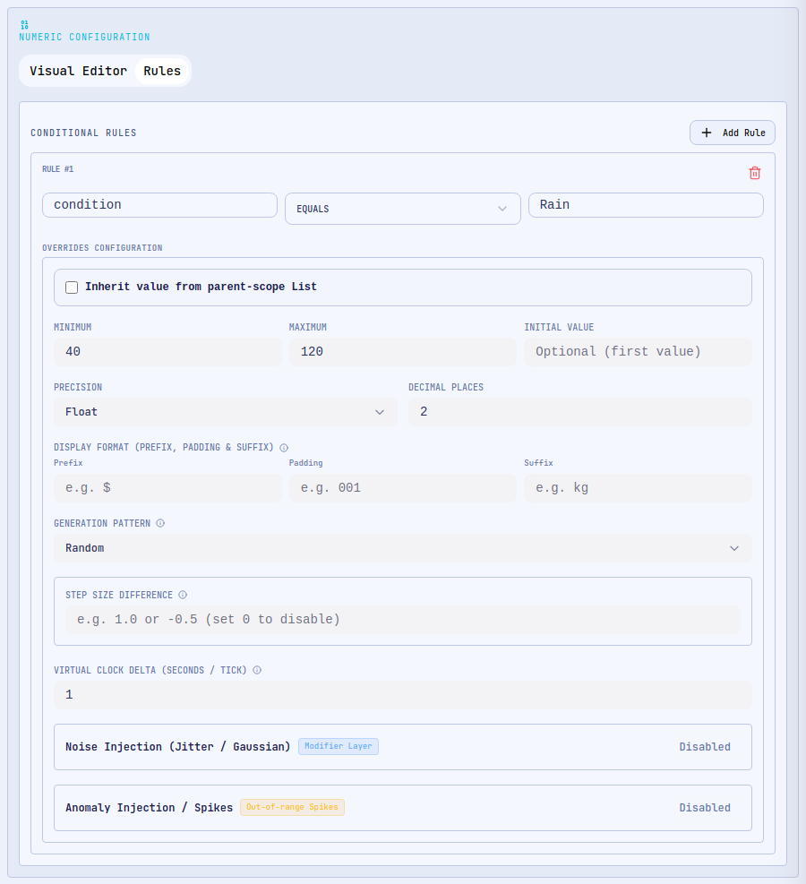

In the **Rules** tab, **Add Rule** creates a rule that replaces the value of this variable when a
condition on another variable is true.

| Field | What it does |
|---|---|
| Variable | The variable to watch (suggestions show the ones you can reach). |
| Operator | **EQUALS**, **NOT EQUALS**, **GREATER THAN**, **LESS THAN** or **CONTAINS**. Numbers are compared as numbers; anything else as text. |
| Value | The value to compare with. |
| **Overrides Configuration** | The value to send while the condition holds. |

How rules work:

- The watched variable is generated first, and the rule sees the same value that goes into the
  message.
- Rules are checked in order; the **first** rule that matches wins. When none matches, the
  variable uses its normal pattern.
- The **Overrides Configuration** is the same visual editor as the variable itself. While the
  rule matches, the variable is generated from that configuration: for example a temperature that
  is normally Random 15–30 can become **Random 40–120** while a `condition` variable equals `Rain`.
  When the rule stops matching, the normal pattern takes over again.
- A fixed replacement also works: choose **Constant** (Numeric) and type the **Constant Value**,
  choose **Fixed** (String) and type the **Constant String Value**, or set **Initial State**
  (Boolean, pattern **Constant State**).
- If the override is left empty, the rule sends its comparison **Value** instead.

> **Tip:** as soon as you change any field of the override, the pattern shown in its editor is
> saved with it (Random for Numeric, for example), so the rule generates exactly what the editor
> shows. In Boolean overrides the **Initial State** starts OFF, like a new Boolean variable.

Typical uses: an alarm flag that is `true` when the temperature is above a threshold, a fan speed
that jumps to its maximum when a machine is in `FAULT`, a status text that follows a numeric value.

---

### Numeric variables

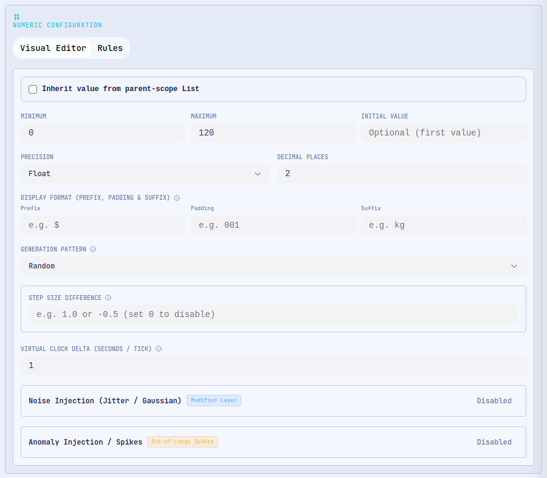

**Common fields** (shown for every pattern except Constant, which hides the range and precision):

| Field | What it does | Default / range |
|---|---|---|
| **Minimum** / **Maximum** | Range of the Random, Distribution and Sequential patterns and limits of Drift. | 0 / 100 |
| **Initial Value** | Optional. First value emitted by the **Random** and **Sequential** patterns; also the start of **Linear Drift** when its own Initial Value is empty. Must be inside the range. | Empty |
| **Precision** | **Float** (decimals) or **Integer** (whole numbers; other patterns drop the decimals, 23.9 → 23). | Float |
| **Decimal Places** | Rounding of Float values. | 2 (0–10) |
| **Prefix** / **Padding** / **Suffix** | Text added before and after the number, and zero padding of the integer part (`001` turns 5 into `005`). Any of them turns the value into text. | Empty |
| **Generation Pattern** | Random, Constant, Sequential, Distribution, Formula, Sinusoidal Wave or Linear Drift. | Random |
| **Virtual Clock Delta (seconds / tick)** | Simulated seconds that pass between two values. Only used by Sinusoidal Wave and Linear Drift. | 1.0 |

#### Random

Uniform random value between Minimum and Maximum. With **Integer** precision every whole number
from Minimum to Maximum, both included, is equally likely.

| Field | What it does | Default |
|---|---|---|
| **Step size difference** | When greater than 0, values are Minimum + k × step (k = 0, 1, 2…, up to Maximum). Must be positive and not larger than the range; 0 disables it. | 0 |

*When to use it:* noisy readings with no memory (temperature samples, ping times).

#### Constant

| Field | What it does | Default |
|---|---|---|
| **Constant Value** | The value sent every time. Type it: an untouched field sends 0. | — |
| **Oscillation Margin (+/-)** | When greater than 0, a uniform random amount between −margin and +margin is added. The result is kept inside the (hidden) Minimum–Maximum range, so if your constant is outside 0–100 set the range first under another pattern. | 0 |

*When to use it:* fixed attributes (a firmware version, a set point), or a nominal value with a
little jitter.

#### Sequential

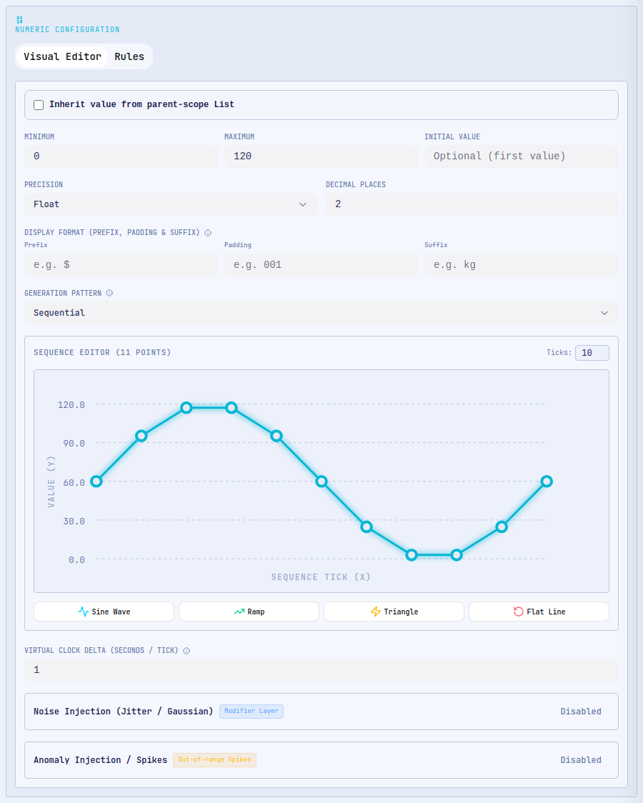

Plays a curve that you draw, point by point, and loops it forever.

| Control | What it does | Default / range |
|---|---|---|
| **Ticks** | Length of the curve: points are placed at positions 0…N, so the curve has N + 1 points. | 10 (2–50) |
| Points | Drag each point up or down to set its value (between Minimum and Maximum, rounded to 2 decimals). | Sine wave |
| **Sine Wave**, **Ramp**, **Triangle**, **Flat Line** | Redraw the whole curve with a preset shape. | — |

How it plays: every drawn point is sent once per cycle, from position 0 to position N, and then
the curve starts again. With **Ticks** = 10 a cycle has 11 values. The **Sine Wave** and
**Triangle** presets are drawn over those N + 1 steps, so the loop does not repeat a value at the
joint. When **Initial Value** is set, it replaces the first value only.

*When to use it:* deterministic scripted shapes that repeat exactly, such as a daily cycle or a
staircase that crosses a threshold at known moments. For exact typed values, a
[List with Sequential strategy](#list-variables) is even easier.

#### Distribution

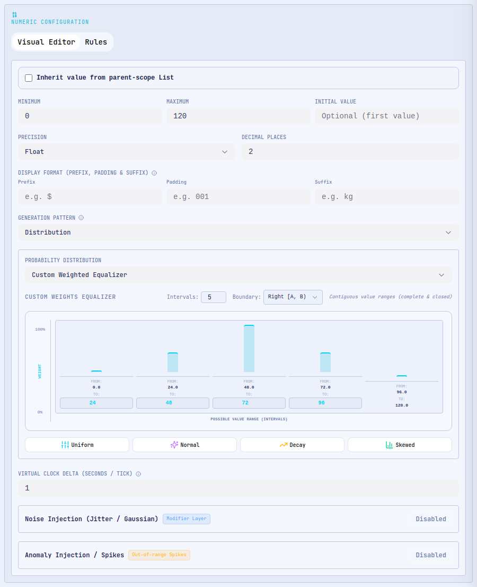

| Field | What it does | Default |
|---|---|---|
| **Probability Distribution** | **Uniform:** every value in the range is equally likely. **Normal / Gaussian:** bell curve centred on the middle of the range, with standard deviation (Maximum − Minimum) / 6, so almost all values fall inside the range (the rare ones outside are cut to the limits). **Exponential:** many values near Minimum and fewer towards Maximum (mean Minimum + range/5, cut at Maximum). **Custom Weighted Equalizer:** you draw the shape. | Uniform |

**Custom Weighted Equalizer:**

| Control | What it does | Default / range |
|---|---|---|
| **Intervals** | Number of value ranges (bars). Changing it resets the bars to uniform. | 5 (2–15) |
| Bar slider | Weight of each range: the probability of picking it is its weight divided by the sum of weights. | 50 (0–100) |
| **TO** | Upper limit of a range (the next range starts there). | Equal splits |
| **Boundary** | How the limits are included: **Right [A, B)**, **Left (A, B]** or **Split (50/50)**. | Right |
| **Uniform**, **Normal**, **Decay**, **Skewed** | Presets for the weights. | — |

*When to use it:* realistic histograms (most readings normal, a few high), bimodal data, or rare
categories of values.

#### Formula

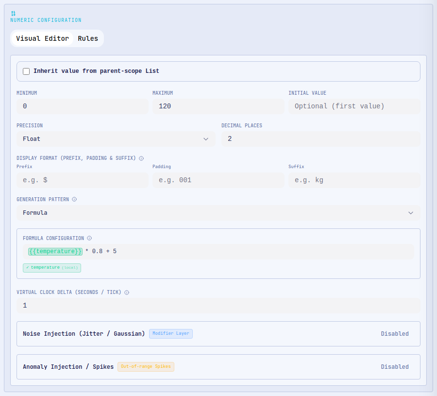

Computes the value from other variables with a mathematical expression, for example
`{{temperature}} * 1.8 + 32` or `100 - {{temperature}} * 2`.

- Reference variables with `{{name}}` (or `[name]`), using the bare name, without scope or
  sub-property. Type `{{` to autocomplete; references are green when valid and red when the
  variable is unknown or out of scope.
- Operators `+ - * / ^ %`, parentheses, the constants `pi` and `e`, and functions such as `abs`,
  `sqrt`, `pow(x, y)`, `exp`, `log`, `log10`, `sin`, `cos`, `tan`, `floor`, `ceil` and `signum`.
- The referenced variables are generated first, and the formula sees exactly the values that go
  into the same message. Numeric variables with prefix or suffix are read as numbers.
- Circular references (A uses B and B uses A) are rejected. An expression that cannot be evaluated
  gives 0 and a warning in the logs.
- Noise and spikes are applied after the formula, so `Formula + Noise` gives a correlated but not
  identical signal.

*When to use it:* correlated sensors (dew point from temperature and humidity, fuel use from engine
speed), unit conversions, derived alarms.

#### Sinusoidal Wave

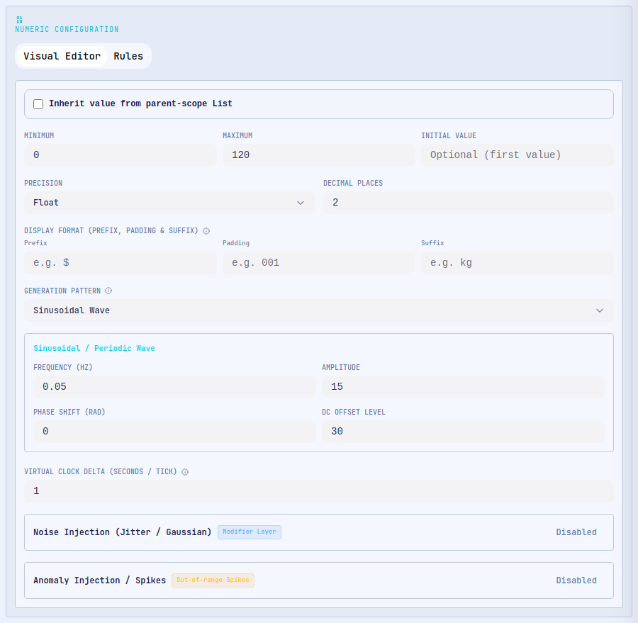

value = **DC Offset Level** + **Amplitude** × sin(2π × **Frequency** × t + **Phase Shift**),
where t = (n − 1) × **Virtual Clock Delta** for the n-th value.

| Field | What it does | Default |
|---|---|---|
| **Frequency (Hz)** | Cycles per simulated second. The period is 1 / Frequency seconds. | 0.05 (20 s period) |
| **Amplitude** | Half the distance between the peak and the trough. | 10.0 |
| **Phase Shift (rad)** | Shifts the wave in time (π/2 ≈ 1.571 starts at the peak). | 0.0 |
| **DC Offset Level** | The centre line of the wave. | 0.0 |

The wave is not limited by Minimum/Maximum: it goes from Offset − Amplitude to Offset +
Amplitude.

> **Tip:** choose a period much longer than the Virtual Clock Delta. The default (0.05 Hz with
> 1 s per value) gives a cycle of 20 values. A period equal to the delta (1 Hz with 1 s per value)
> samples the same point of the wave every time and produces a flat line. For a cycle of 60 values
> with a delta of 1 s, use Frequency = 1/60 ≈ `0.0167`.

*When to use it:* periodic signals such as day/night temperature, tides, vibration, load cycles.

#### Linear Drift

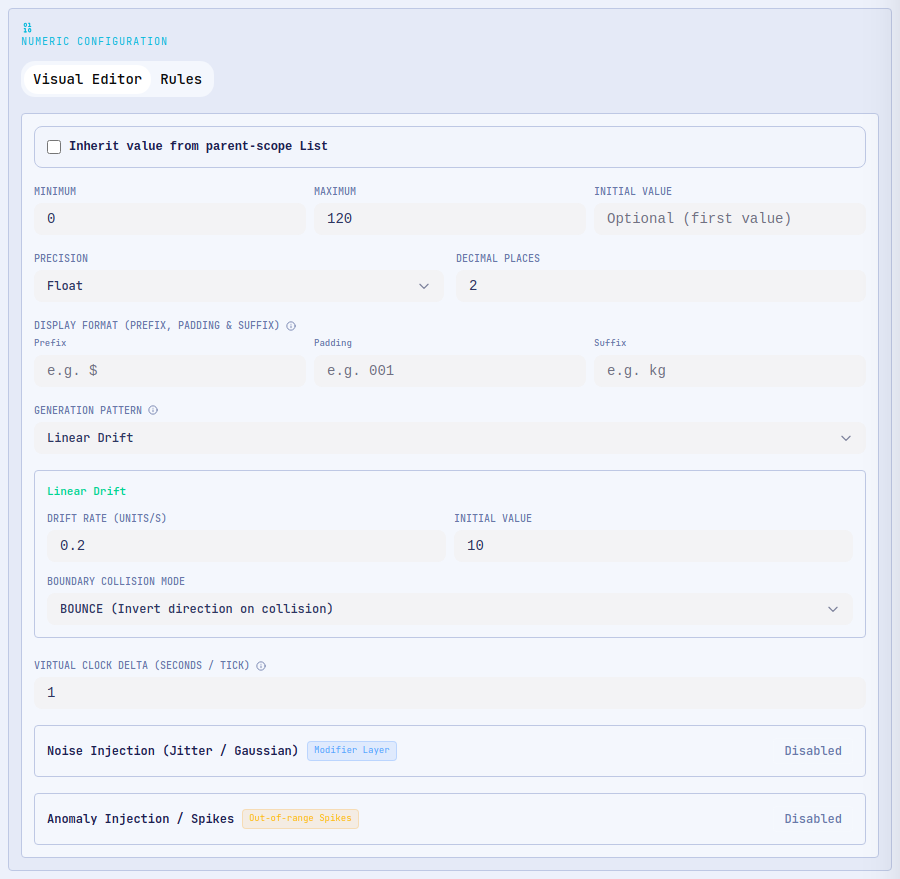

value = start + **Drift Rate** × t, where t = (n − 1) × **Virtual Clock Delta**.

| Field | What it does | Default |
|---|---|---|
| **Drift Rate (units/s)** | Change per simulated second; negative values go down. With a delta of 1 s, it is the change per value. | 0.5 |
| **Initial Value** | Start value; when empty, the common **Initial Value**, or else **Minimum**. | Empty |
| **Boundary Collision Mode** | What happens at Minimum/Maximum. **CLAMP:** stays at the limit. **WRAP / RESET:** jumps back to the opposite limit and keeps drifting (a sawtooth). **BOUNCE:** reverses direction at each limit, a triangle wave between Minimum and Maximum (for example 6, 8, 10, 8, 6, 4…). | CLAMP |

*When to use it:* sensor degradation, slow leaks, battery discharge, wear, a creeping
calibration error. Combine with Noise for a realistic signal.

#### Noise and spikes

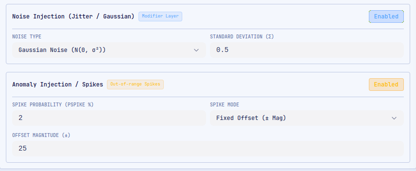

Two optional layers, available for every pattern, are applied in this order: pattern → noise →
spike. Neither is limited by Minimum/Maximum.

**Noise Injection (Jitter / Gaussian)** — click **Disabled/Enabled** to toggle:

| Field | What it does | Default |
|---|---|---|
| **Noise Type** | **Gaussian Noise (N(0, σ²))** adds a normally distributed amount; **Uniform Jitter (± Noise)** adds a uniform amount. | Gaussian |
| **Standard Deviation (σ)** | Spread of the Gaussian noise (about 68 % of the values move less than σ). | 1.0 |
| **Jitter Amplitude (±)** | Maximum amount of the uniform jitter. | 1.0 |

**Anomaly Injection / Spikes** — on every value, with some probability, the value is replaced by
an anomaly:

| Field | What it does | Default |
|---|---|---|
| **Spike Probability (Pspike %)** | Chance of a spike on each value, in percent. | 5 (0–100) |
| **Spike Mode** | **Fixed Offset (± Mag):** adds or subtracts **Offset Magnitude (±)** (random sign). **Critical Range (Min..Max):** replaces the value by a random value between **Min Spike Value** and **Max Spike Value**. **Multiplier (Base × K):** multiplies the value by **Multiplier Factor (K)**. | Fixed Offset |
| **Offset Magnitude (±)** | Size of a fixed-offset spike. | 50.0 |
| **Min Spike Value** / **Max Spike Value** | Range of critical-range spikes. | 100.0 / 200.0 |
| **Multiplier Factor (K)** | Factor of multiplier spikes. | 2.0 |

*When to use it:* threshold-crossing anomalies, glitches and outliers that your CEP rules must
detect (or ignore).

---

### String variables

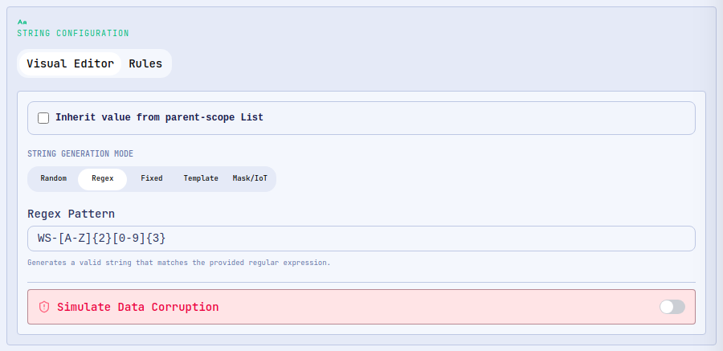

#### String: modes

Choose the **String Generation Mode** with the tabs:

| Mode | Fields | What it produces |
|---|---|---|
| **Random** | **Fixed Length** (default 8, > 0) | Random letters and digits (`a-z`, `A-Z`, `0-9`). |
| **Regex** | **Regex Pattern** | A random text that matches the regular expression, e.g. `WS-[0-9]{3}` → `WS-482`, `(OK\|WARN\|FAIL)` → `WARN`. |
| **Fixed** | **Constant String Value** | Always the same text. |
| **Template** | **Dynamic Template String** | A text built from other variables, e.g. `DEV-{{site}}-{{zone}}`. Use bare names (no scope, no sub-properties); type `{{` to autocomplete. |
| **Mask/IoT** | **Preset Format Mask**, **Custom Format Pattern**, **Case Formatting** | Formatted identifiers, see below. |

When you switch to a mode whose field is empty, GenSynth fills in a working example (Regex
`[A-Z]{3}-[0-9]{4}`, Fixed `active`, Template `DEV-001`, Mask/IoT **Random Alphanumeric**
`????????`).

#### String: masks

**Mask/IoT presets:** **MAC Address**, **IPv4 Address**, **IPv6 Address**, **UUID v4**,
**Random Alphanumeric** and **Custom Format Mask**. The last two use the **Custom Format Pattern**
(default `????????` and `SENSOR-####-$$$$`; an empty pattern generates empty strings):

| Symbol | Replaced by |
|---|---|
| `#` | A digit 0–9 |
| `@` | A letter |
| `$` | A hexadecimal digit 0–F |
| `?` | A letter or a digit |
| Anything else | Copied as written, letters and digits included |

For example `MSG-###-?` → `MSG-482-K` and `SN-@@-$$$$` → `SN-QD-9F3A`. **Case Formatting** applies
only to the letters generated by `@`, `$` and `?`: **UPPERCASE**, **lowercase**, or **Mixed Case**
(either case at random, e.g. `qD-9f`). The text you write around the symbols is never changed.

#### String: data corruption

**Simulate Data Corruption** (switch) damages some values on purpose:

| Field | What it does | Default |
|---|---|---|
| **Anomaly Mode** | **Truncate end of string**, **Inject anomalous characters** (symbols), **Replace characters randomly** (with `?`), **Inject Null Byte (\0)**, or **Mixed / Random corruption** (one of them at random). | Mixed |
| **Probability** | Chance of corrupting each value, from 0 to 1 (0.05 = 5 %). | 0.05 |
| **Magnitude (Chars affected/Truncated)** | How many characters are removed, injected or replaced. | 1 |

*When to use it:* device IDs, serial numbers, firmware strings, status texts, and malformed data
to test the robustness of your consumers.

---

### List variables

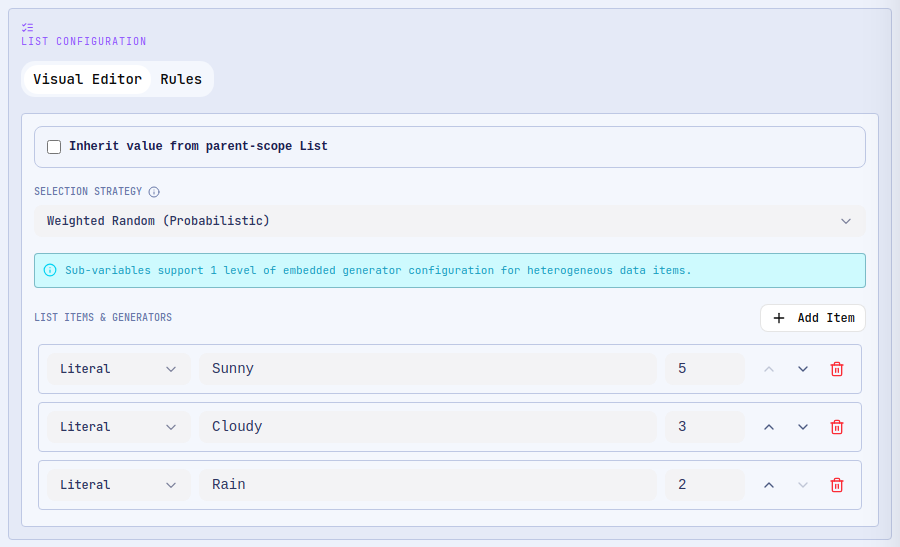

A list picks values from items that you define.

| Field | What it does | Default |
|---|---|---|
| **Selection Strategy** | How the next item is chosen (see below). | Weighted Random |
| **Add Item** | Adds an item. | — |
| Item type | **Literal** (a fixed value you type in **Value (Literal)**) or **Dynamic Generator** (a small Numeric, String, Boolean or Temporal generator; click **Configure Item** to set it up). | Literal |
| **Weight** | Relative probability of the item (Weighted Random only). Weights do not need to add up to 100. | 1 (≥ 0) |
| Move Up / Move Down / Delete | Reorder or remove items. The order matters for Sequential, Markov and Fixed Subset. | — |

#### List: selection strategies

| Strategy | What it does | When to use it |
|---|---|---|
| **Weighted Random (Probabilistic)** | Picks one item at random, according to the weights. | Categories with realistic frequencies (`OK` 90 %, `WARN` 9 %, `FAIL` 1 %). |
| **Sequential (Round-Robin)** | Item 1, 2, 3… then back to item 1. | Exact scripted sequences: type the values and they come out in order, every time. |
| **Shuffle (No repeat until exhausted)** | All items in random order, without repeating until all have been used, then reshuffles. | Visiting every value once per cycle in an unpredictable order. |
| **Markov Chain (State Transition Matrix)** | The next item depends on the current one, with the probabilities of the matrix. | State machines (IDLE → RUNNING → FAULT…). |
| **Fixed Subset / Entire List (Returns array of items)** | Returns all the items at once, as a JSON array. Reach single items with `{{name.item0}}`, `{{name.item1}}`… | Sending a vector of readings, or several related values that change together. |

Literal items are inserted as written: in JSON, quote text items (`"{{condition}}"`) and leave
numeric items unquoted. Dynamic items generate a new value each time they are picked. A list only
has its own items: it cannot inherit items from another list.

#### List: Markov chain

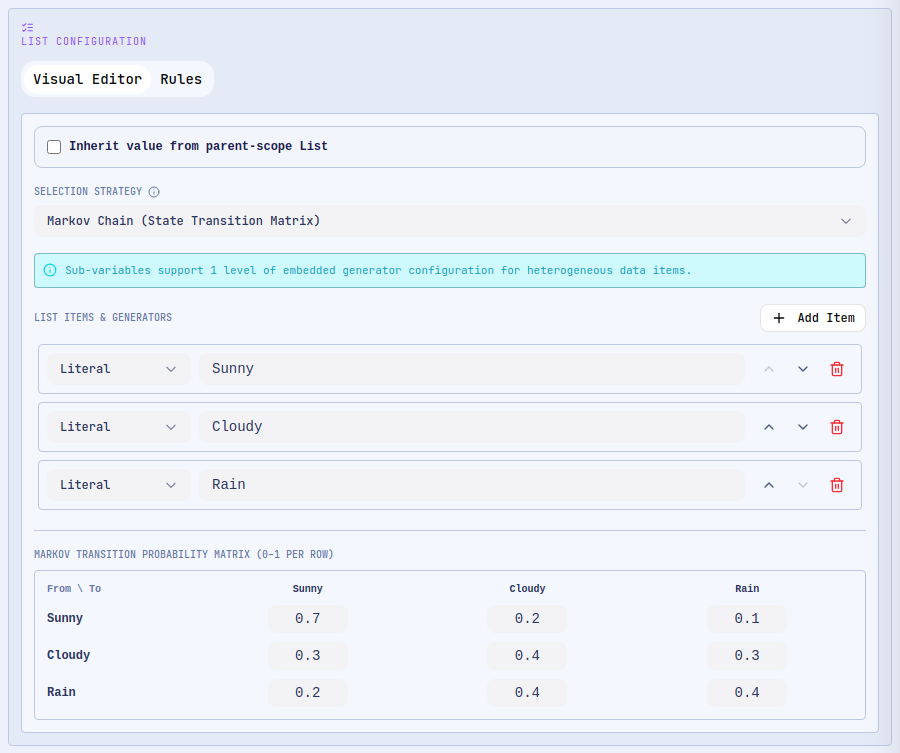

The **Markov Transition Probability Matrix** has one row per current state (**From**) and one
column per next state (**To**). Each cell is the probability of moving from the row state to the
column state, as a fraction between 0 and 1 (the title says **(0–1 per row)**). Cells show up to
three decimals, and an empty cell counts as 0. Rows are normalised, so they do not need to add up
to exactly 1. Adding or deleting an item rescales the other probabilities of each row so that it
still adds up to 1.

- The chain starts in the first item of the list as shown (after Move Up / Move Down), and the
  first value sent is that item.
- A row with all zeros is a dead end: the chain stays in that state forever.
- An item without a row (for example in a project file edited by hand) shows an even row: it
  moves to any item with the same probability until you edit it.
- A high value on the diagonal makes states "sticky" (long runs of the same state).

Example for a machine (rows = from, columns = to):

| From \ To | IDLE | RUNNING | FAULT |
|---|---|---|---|
| IDLE | 0.7 | 0.3 | 0 |
| RUNNING | 0.1 | 0.85 | 0.05 |
| FAULT | 0.5 | 0 | 0.5 |

---

### Boolean variables

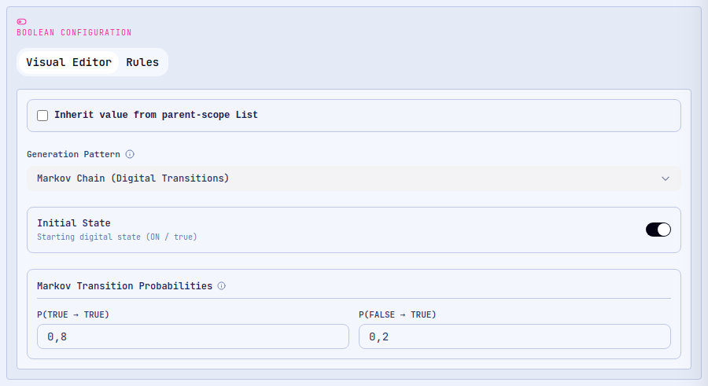

| Field | What it does | Default |
|---|---|---|
| **Generation Pattern** | See the table below. | Constant State |
| **Initial State** | Starting value (ON = `true`). The Constant pattern always sends it; the cyclic patterns start from it. | OFF (`false`) |

#### Boolean: patterns

| Pattern | Fields | Behaviour |
|---|---|---|
| **Constant State (Fixed ON/OFF)** | — | Always the **Initial State**. |
| **Probability Ratio P(true)** | **Probability P(true)** (0–1, default 0.5) | Each value is `true` with that probability, independently. |
| **Flip Interval (Periodic Inversion)** | **Flip Interval N (cycles)** (≥ 1, default 1) | N values with the initial state, then N with the opposite one, and so on. |
| **Burst Mode (Active Burst Cycles)** | **Burst Active (ticks)** (≥ 1, default 5), **Burst Idle (ticks)** (≥ 0, default 5) | `true` during the active values, `false` during the idle ones, repeating. Start the Initial State OFF to begin with an idle period. |
| **Markov Chain (Digital Transitions)** | **P(TRUE → TRUE)** (default 0.8), **P(FALSE → TRUE)** (default 0.2) | Random two-state chain: high P(TRUE → TRUE) gives long `true` runs, low P(FALSE → TRUE) gives long `false` runs. |
| **Duty Cycle (ON/OFF Durations)** | **ON Duration (ticks)**, **OFF Duration (ticks)** (≥ 1, default 1) | Same as Burst Mode, for an ON/OFF device such as a pump or heater. |
| **Alternating Toggles** | **Alternation Interval (ticks)** (≥ 1, default 1) | Same as Flip Interval. |

The durations count values of the variable, not global ticks (see [Ticks](#ticks)).

*When to use it:* door open/closed, motor on/off, alarm flags, "burst" windows that drive other
variables through [conditional rules](#conditional-rules).

---

### Temporal variables

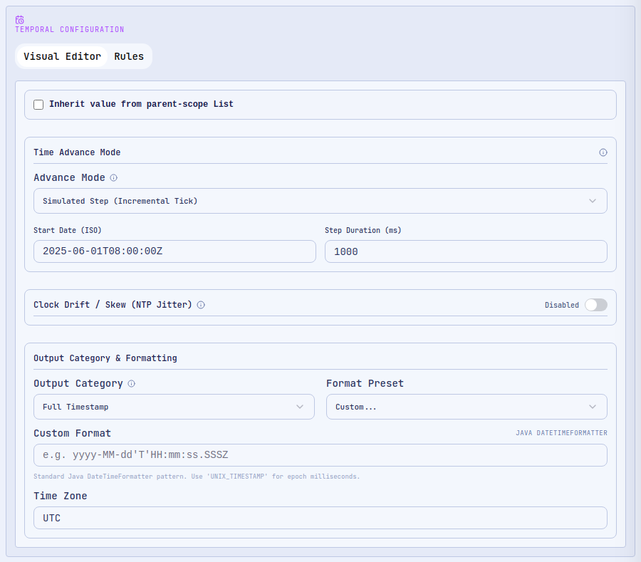

#### Temporal: advance mode

**Advance Mode** sets how the dates move forward:

| Mode | Fields | What it produces |
|---|---|---|
| **Wall Clock (Real System Time)** | — | The computer's current time when the message is generated. |
| **Simulated Step (Incremental Tick)** | **Start Date (ISO)**, **Step Duration (ms)** (default 1000) | Start, start + step, start + 2 × step… one step per value. An empty start means the moment the simulation starts. |
| **Backfill Historical (Mass Range)** | **Range Start (ISO)**, **Range End (ISO)**, **Sampling Strategy**, **Step Duration (ms)** (default 60000) | Dates inside a past range. **Sequential Step** walks from start to end in steps and wraps around; **Random Uniform in Span** picks random dates. Empty range: the last 7 days; empty end: one hour after the start. |
| **Fixed (Constant Timestamp)** | **Fixed Date/Time (ISO)** | Always the same date. Empty: the moment the simulation starts. |

Write ISO dates with a time zone, e.g. `2026-01-01T00:00:00Z` (dates without `Z` or an offset
are ignored).

#### Temporal: clock drift

**Clock Drift / Skew (NTP Jitter)** (switch) imitates imperfect device clocks:

| Field | What it does | Default |
|---|---|---|
| **Drift Mode** | **Random Jitter (± Bounds):** adds a random amount between −max and +max ms to each value, so timestamps can arrive slightly out of order. **Constant Static Shift:** adds a fixed number of ms. **Progressive Drift / Tick:** adds n × rate ms to value n (counting from 0), a clock that runs fast or slow. | Random Jitter |
| **Max Jitter Bound (ms)** / **Static Shift (ms)** | Size of the jitter or of the shift. | 0 |
| **Drift Rate (ms / tick)** | Extra ms per value for Progressive Drift. Works in every advance mode (Wall Clock, Simulated Step, Backfill with both strategies, Fixed). | 1.0 |

#### Temporal: output format

**Output Category & Formatting** sets how the date is written:

| Field | What it does | Default |
|---|---|---|
| **Output Category** | **Date Only**, **Full Timestamp** or **Time Only**. Changing it selects the first preset of the category. | Full Timestamp |
| **Format Preset** | Date only: `yyyy-MM-dd`, `dd/MM/yyyy`, `MM-dd-yyyy`, `yyyy.MM.dd`. Full: `yyyy-MM-dd'T'HH:mm:ss.SSSZ`, `ISO_INSTANT`, `UNIX_TIMESTAMP`, `yyyy-MM-dd HH:mm:ss`. Time only: `HH:mm:ss`, `HH:mm`, `HH:mm:ss.SSS`, `hh:mm a`. | `yyyy-MM-dd'T'HH:mm:ss.SSSZ` |
| **Custom Format** | Any Java `DateTimeFormatter` pattern, or `UNIX_TIMESTAMP` for epoch milliseconds (a number). Month and day names (`MMMM`, `EEEE`) are always in English, whatever the computer's language. | — |
| **Time Zone** | Zone used to format the date, e.g. `UTC`, `Europe/Madrid`, `-05:00`. Empty: the computer's zone. | Empty |

> **Tip:** for event time, use `UNIX_TIMESTAMP` (a number, no quotes in JSON). For readable text,
> use the `ISO_INSTANT` preset, which writes ISO-8601 in UTC (`2026-01-01T00:00:00Z`) whatever the
> time zone.

---

### Point variables

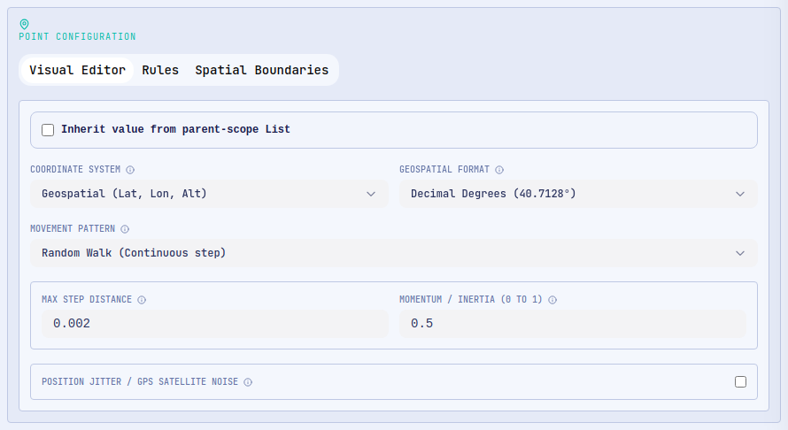

Points model positions: a robot on a factory floor, a vehicle on a map, a drone in the air.

#### Point: visual editor

| Field | What it does | Default |
|---|---|---|
| **Coordinate System** | **2D Cartesian (X, Y)**, **3D Cartesian (X, Y, Z)** or **Geospatial (Lat, Lon, Alt)** (WGS84 degrees and an altitude). What a change keeps is explained in [Changing the coordinate system](#changing-the-coordinate-system). | 3D Cartesian |
| **Geospatial Format** | **Decimal Degrees** or **Degrees, Minutes, Sec (DMS)** (text such as `40° 25' 0.48" N`). | Decimal |
| **Boundary Behavior** | What happens when a moving point reaches the limits: **Clamp (Stop at boundary)**, **Bounce (Rebound velocity)** or **Wrap (Toroidal space)**. | Clamp |
| **Movement Pattern** | See below. | Random Point |
| **Position Jitter / GPS Satellite Noise** + **Random Jitter Noise Radius** | Adds Gaussian noise of that size (in coordinate units; degrees in Geospatial) to every coordinate, like a real GPS. | Off / 0 |

#### Point: movement patterns

| Pattern | Fields | Behaviour |
|---|---|---|
| **Fixed Point (Constant)** | X/Y/Z (Latitude/Longitude/Altitude) | Always the same position. |
| **Random Point (Within bounds)** | — | A new random position inside the region on every value: inside the polygon if you drew one (2D and Geospatial) or inside the drawn shape (3D), and outside forbidden zones. |
| **Random Walk (Continuous step)** | **Max Step Distance** (default 10), **Momentum / Inertia (0 to 1)** (default 0) | Moves a random step of up to Max Step Distance per coordinate from the previous position (when the step is larger than the area, 5 % of the area is used). Inertia keeps the previous direction (smooth paths with values near 1). It starts at the Fixed Point coordinates when they are set and inside the region (the polygon in 2D/Geospatial, the 3D shape in 3D) and outside obstacles; otherwise at a random valid position. It avoids walls and forbidden zones, and in 2D/Geospatial a step never ends outside the custom polygon nor cuts across it: keep Max Step Distance smaller than narrow passages, or the point may wait in place. In Geospatial mode 0.000009° ≈ 1 m, 0.00009° ≈ 10 m, 0.0009° ≈ 100 m. |
| **Circular Orbit / Spiral** | **Orbit Radius** (default 10), **Angular Speed (rad/tick)** (default 0.1), **Spiral Rate (+/- r/tick)** (default 0) | Circles around the centre of the region (the centre of the bounding box), whatever Min X is; a spiral rate grows or shrinks the radius on each value. 2π / angular speed values make a full turn. |
| **Waypoint Navigation** | The [waypoint editor](#point-waypoint-editor), **Loop Path** (default on), **Interpolation Steps** (default 1) | Travels along the waypoints in order. Each segment takes Interpolation Steps values: each waypoint appears once, followed by Steps − 1 evenly spaced points towards the next one. With **Loop Path** on, after the last waypoint it travels back to the first and repeats (a lap takes Steps × number of waypoints values); off, it stops on the last waypoint. The generator uses the waypoints as they are (it does not clamp them); in 2D and Geospatial the editor rejects points outside the region or in forbidden zones. Available in 2D, 3D and Geospatial. |
| **Graph Route (Connected Graph Path)** | See below (2D and Geospatial only) | Moves along the edges of a graph of nodes that you draw. |

#### Point: waypoint editor

With the **Waypoint Navigation** pattern, the **Visual Editor** shows the waypoint editor.

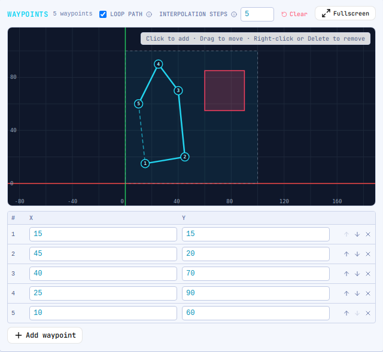

| Element | What it does | Default |
|---|---|---|
| **WAYPOINTS** | Title, with the number of waypoints (*N waypoints*). | — |
| **Loop Path** | On: after the last waypoint the point travels back to the first and repeats the path. Off: it stops on the last waypoint. | On |
| **Interpolation Steps** | Values per segment, a whole number of at least 1. Applied when you leave the field or press `Enter`. | 1 |
| **Clear** | Deletes every waypoint after asking *Clear all waypoints?* (**Yes** / **No**; `Esc` cancels). | — |
| **Fullscreen** | 2D and Geospatial: opens the editor on the whole window, with the plane or map on the left and the table on the right. **Exit Fullscreen** or `Esc` go back; the map keeps its view. | — |
| Visual area | A plane in 2D or a map in Geospatial, see below. | — |
| Table | One row per waypoint, see below. | — |

**Visual area:**

- **2D:** a plane with the region (the dashed min/max box, plus the polygon if you drew one), the
  enabled obstacles in red, the numbered path and, when **Loop Path** is on and there are 3 or more
  waypoints, a dashed segment that closes the loop. Both axes use the same scale.
- **Geospatial:** a map (OpenStreetMap tiles, or a technical grid when there is no connection) with
  the region polygon or the min/max rectangle, the obstacles, the path with numbered markers and
  the closing line. It fits the region when it opens; double-clicking does not zoom.
- **3D:** there is no visual editor; the editor asks you to *Enter the coordinates in the table*.

On the 2D plane and on the map (the hint line says *Click to add · Drag to move · Right-click or
Delete to remove*):

- click empty space to append a waypoint at the end of the path (a click just outside the edge of
  the region places it on the edge);
- drag a waypoint to move it: the move is applied when you release the mouse. The waypoint stops at
  the edge of the region, and it turns red (with its segments) while the drop would be rejected,
  for example inside a forbidden zone; a rejected drop goes back;
- right-click a waypoint to delete it, or click it to select it and press `Delete` or `Backspace`.

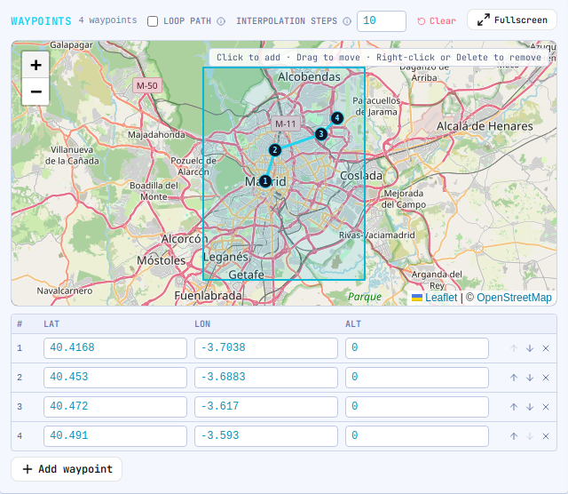

**Table:** columns **#**, **X**, **Y** and **Z** (**Lat**, **Lon** and **Alt** in Geospatial; no
Z in 2D), with ↑ / ↓ on each row to move the waypoint up or down in the path and ✕ to delete it.
**+ Add waypoint** adds one at the centre of the region (the first) or next to the last one
(shifted 5 % of the region span), with the same Z or altitude; when that place is not valid (outside
a custom polygon, inside an obstacle) it looks for the nearest valid one. The fields
are applied when you leave them or press `Enter`; text that is not a number is rejected, latitude
is limited to ±90 and longitude to ±180.

**Validation:** in 2D and Geospatial, a waypoint inside a forbidden obstacle or outside the region,
or a segment that crosses a wall or a forbidden zone or leaves the region, is rejected; a waypoint
on the edge of the region, or a segment along it, is valid. In 3D, a waypoint outside the 3D shape
is rejected. A red warning appears over the editor (✕ closes it) and the value goes back.

Waypoints that were already stored and are no longer valid (for example after changing the region
in **Spatial Boundaries**) are drawn in red, their row number turns red (hover it to see why), and a
notice above the editor counts them. The generator follows the path as it is, so fix or move them.

#### Point: graph route

Draw the graph on the canvas or map of the route editor with its tools. A hint line at the
top-right of the editor reminds you what the active tool does.

| Tool | What it does |
|---|---|
| **Add & Extend** | Click empty space to add a node linked to the selected one (the first click places the first node). Clicking an existing node does not add a new one. |
| **Connect Nodes** | Click the origin, then the target, to link two existing nodes. `Esc` cancels a pending connection. |
| **Select / Move** | Click a node to select it: it becomes the origin of the next Add & Extend step. |
| **Delete** | Click a node or an edge to delete it. |
| Trash button | Clears the whole graph. |

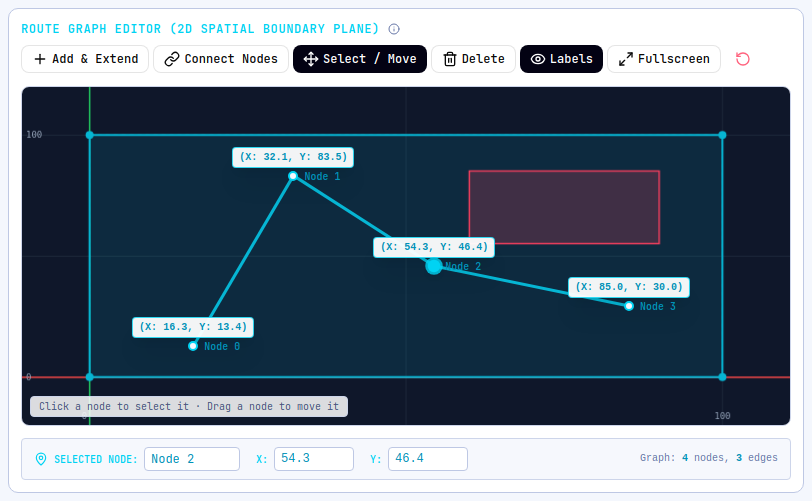

- Drag a node to move it, with **Add & Extend** or **Select / Move**, on the 2D canvas and on the
  map. The move is applied when you release the mouse.
- Selecting a node lets you rename it and edit its coordinates; the name and the coordinates are
  applied when you leave the field or press `Enter`.
- The 2D canvas uses the same scale on both axes (a 200 × 100 region looks twice as wide as it is
  tall) and its grid fills the canvas. On the map, the bounding box is drawn as a rectangle when
  the region has no polygon.
- Edges cannot cross forbidden zones. Warnings appear over the top of the editor and can be closed
  with their dismiss button.
- **Fullscreen** opens the editor on the whole window and keeps the current map view; `Esc` exits
  fullscreen (when no connection is pending). Double-clicking the map does not zoom it.

| Field | What it does | Default |
|---|---|---|
| **Graph Navigation Mode** | **Random Neighbor (Graph Walk):** at each node, go to a random connected node. **Fixed Sequence (Node Path):** follow the order you build in **Fixed Sequence Path Order** (pick the start node, then add neighbours; **Clear Path** empties it). A node can appear more than once (A → B → A → C). | Random Neighbor |
| **Ticks Per Edge (Interpolation)** | Number of values needed to travel an edge (1 = jump from node to node). | 1 |
| **Pause Probability (0.0 - 1.0)** | Chance of stopping when arriving at a node. | 0 |
| **Pause Duration (Ticks)** | How many values the stop lasts. | 0 |
| **Prevent Cyclic Loops (Anti-Backtracking)** | Random Neighbor avoids the last visited nodes when it has another choice. | On |
| **Loop Sequence** | Fixed Sequence starts again at the end; otherwise it stays at the last node. | On |

The value then includes `nodeId`, `nodeName`, `targetNodeId`, `targetNodeName` and `isPaused`,
handy for "vehicle arrived at depot" events.

#### Point: spatial boundaries

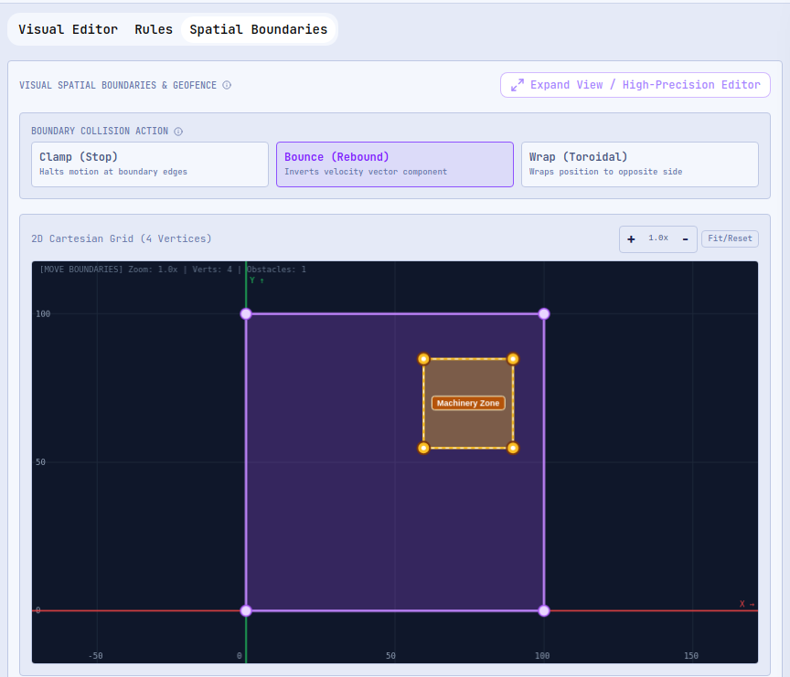

The **Spatial Boundaries** tab sets the region where the point lives.

| Element | What it does | Default |
|---|---|---|
| Visual editor | 2D canvas, 3D view or world map, depending on the Coordinate System (see below). **Fullscreen** opens the editor on the whole window, with presets (**Square**, **Triangle**, **Circle**, **New Region**), zoom and obstacle management (in Geospatial the altitude settings stay in the tab); **Exit Fullscreen**, **Done** or `Esc` close it. | — |
| **Boundary Collision Action** | Same as Boundary Behavior. | Clamp |
| **Outer Envelope Bounding Box (AABB Bounds)** | **Min/Max X, Y, Z** (Latitude, Longitude, Altitude in Geospatial): the box the point lives in. | 0–100 on every axis |
| **Exact Individual Polygon Vertices** | 2D and Geospatial: the vertices of a custom polygon (3 or more), when you drew one. The box then fits the polygon. In 3D the polygon is not used, and the list only shows the footprint of the drawn shape. | — |
| Barriers & obstacles | **Obstacle Name**, **Type** (**Wall Line Segment** or **Forbidden Interior Polygon**) and **Add Barrier**; each barrier can be disabled or removed. Walls block Random Walk steps; forbidden polygons are never entered. | — |
| Altitude (Geospatial) | **Independent Altitude Dynamics Pattern**: **Follow Primary XY Pattern**, **Fixed Altitude** (the value typed in its **Fixed Altitude** field), **Random Elevation (Uniform in Range)**, **Continuous Climb & Descent Walk** (**Max Vertical Step (m/tick)**), **Sinusoidal Hover Oscillation** (**Oscillation Speed (rad/tick)**); **Min/Max Altitude**, **Initial Altitude (Seed)**, **Altitude Measurement Unit** (m, ft, km, mi) and **Datum / Altitude Reference** (MSL, AGL, ELLIPSOID), which are written in the output. | Follow XY, m, MSL |

How editing works in every boundary and route editor:

- A drag is applied when you release the mouse, so each drag is a single change.
- Numeric fields (bounds, coordinates, altitudes) are applied when you leave the field or press
  `Enter`. Text that is not a number goes back to the previous value, and a minimum greater than
  its maximum is swapped with it.

**2D canvas:**

- The view fits the region automatically; there is no fixed grid, and values are not limited to
  ±100. The mouse wheel zooms around the cursor, and a drag continues if the cursor leaves the
  canvas.
- In **Move Boundaries** mode the region vertices take priority; whole obstacles can only be
  dragged in **Move Obstacles** mode.
- Right-click a vertex or an edge for its menu: insert a vertex on an edge (of the region or of
  an obstacle) or delete a vertex (a region keeps at least 3). Vertices take priority; on an edge,
  the menu is the one of the nearest edge within 10 px.
- The presets (**Square**, **Triangle**, **Circle**) fill the current bounding box, so the region
  does not shrink. New obstacles appear at the centre of the region.
- **New Region** asks for confirmation; `Esc` closes it without changes. In the fullscreen
  editor, the first `Esc` closes the confirmation and the second closes the editor.

**3D view:**

- The shape drawn in the 3D view (cube, pyramid, cone or sphere) is the region where points are
  generated: **Random Point** fills its volume, and **Random Walk** and **Circular Orbit** stay
  inside it. The custom polygon is not used in 3D.
- Its footprint is centred on the X/Y bounds. The base is at **Min Z**, or at **Max Z** when the
  height is negative (a cube, pyramid or cone then points down). A sphere rests on Min Z: its
  centre is Min Z + radius.
- The dimensions you never set follow the bounds: width and length are the X and Y spans (100 when
  a span is 0), the height is Max Z − Min Z and the radius is 50. Once you edit the shape, the
  Min/Max fields only move it; resize it in the 3D view.
- The height handle follows the cursor, and a negative height does not move the base.

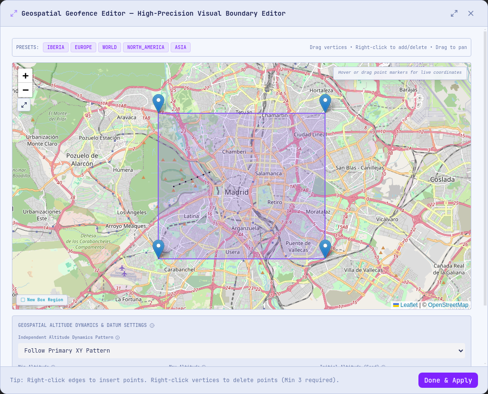

**World map (Geospatial):**

- The polygon follows a vertex while you drag it. Latitude is limited to ±90° and longitude to
  ±180°. Drag empty space to pan the map.
- Right-click on the map to add a vertex on the nearest edge; right-click on a vertex to delete it
  (a region keeps at least 3).
- **New Box Region** asks for confirmation first (`Esc` closes it without changes; in the fullscreen
  editor, the first `Esc` closes the confirmation and the second the editor), and keeps the current
  region until you finish drawing the new box (releasing the mouse outside the map also finishes
  it). The presets and a new box zoom the map to the region.
- The marker icons work offline. The altitude fields are applied when you leave them or press
  `Enter`.

> **Tip:** coordinates are sent with full precision (many decimals). Adjust the bounding box to
> your scenario: new point variables start with every axis from 0 to 100, and a point without
> bounds also generates in that region.

#### Changing the coordinate system

Changing the **Coordinate System** keeps as much of the configuration as the units allow:

- **2D ↔ 3D Cartesian** share units, so the region is kept: bounds, polygon and obstacles. The
  waypoints are kept too (a missing Z becomes 0). Graph Route is not available in 3D: going to 3D
  with Graph Route switches the pattern to **Random Point** and drops the route, after asking you
  first.
- **Cartesian ↔ Geospatial** use different units (coordinate units against degrees). GenSynth
  first asks for confirmation, listing what will be lost, and then:
  - resets the bounds to the defaults of the new system: 0 to 100 on every axis in Cartesian, or
    a city-sized area around Madrid in Geospatial;
  - resets the region polygon, the obstacles, the route graph, the waypoints and the fixed point
    (which moves to the centre of the new region);
  - adapts **Max Step Distance**, **Orbit Radius** and the jitter radius to the new units:
    0.0005°, 0.01° and 0 in Geospatial, 10, 10 and 0 in Cartesian.

---

## Recipes for typical event patterns

All the recipes use LOCAL variables in one flow, so they work per device after cloning.

### Threshold crossings with spikes

A temperature that is normally 18–24 °C and occasionally jumps above 35 °C:

- Numeric `temperature`: **Random**, Minimum 18, Maximum 24, **Decimal Places** 1.
- **Anomaly Injection / Spikes**: Spike Probability `2`, Spike Mode **Critical Range**, Min
  Spike Value `35`, Max Spike Value `40`.

About 2 % of the readings cross the threshold, at random moments. For a reading that crosses it
at *known* moments, use the [scripted sequence](#deterministic-scripted-sequences) recipe.

### Periodic signals

A daily cycle between 10 and 30 °C, one reading per simulated minute:

- Numeric `outdoorTemp`: **Sinusoidal Wave**, DC Offset Level `20`, Amplitude `10`,
  Frequency `0.00001157` (1 / 86 400 s), Phase Shift `-1.571` (starts at the minimum),
  **Virtual Clock Delta** `60`.
- Optional: **Noise Injection**, Gaussian, σ `0.3`.

With a tick of 1 second, a whole simulated day passes in 24 minutes.

### Gradual drift

A pressure sensor that loses 0.02 bar per hour from 6.0 bar:

- Numeric `pressure`: **Linear Drift**, Drift Rate `-0.0000056` (bar per second), Initial Value
  `6.0`, Minimum `0`, Maximum `10`, **Virtual Clock Delta** `60`, Boundary Collision Mode
  **CLAMP**, Decimal Places 3.
- Add Gaussian noise (σ `0.01`) so the trend is hidden in realistic readings.

### State machines with Markov lists

- List `machineState`: **Markov Chain**, literal items `IDLE`, `RUNNING`, `FAULT` (in this
  order: the chain starts in `IDLE`), with the matrix shown in [List variables](#list-variables).
- Template: `"state": "{{machineState}}"`.
- Make another variable follow the state with a conditional rule, for example Numeric `rpm`
  (Random 1400–1600) with the rule `machineState EQUALS IDLE` → Constant `0`.

### Bursts

Short bursts of high activity separated by quiet periods:

- Boolean `burst`: **Burst Mode**, Burst Active `5`, Burst Idle `30`, Initial State OFF.
- Numeric `vibration`: Random 0.1–0.5, with the rule `burst EQUALS true` whose override is
  **Random** 8–10.
- The pace of a flow is fixed, so a burst changes the values, not the number of messages. To
  also raise the event rate, model the bursty source as a second flow with a smaller *Every N
  ticks*, and use **Lock group** / **Unlock group** to switch it on and off by hand. For scheduled
  silences, use the outages of [event loss](#event-loss) instead.

### Missing events (lost messages and outages)

A device that loses some readings and goes silent from time to time, to test how your consumer
detects missing data:

- Numeric `seq`: **Linear Drift**, **Minimum** `1`, **Maximum** a large value such as
  `1000000000`, **Precision** **Integer**, **Drift Rate** `1`, **Virtual Clock Delta** `1`. It
  counts 1, 2, 3…, one per message of the flow.
- Template: `{"device": "{{flow.name}}", "seq": {{seq}}, …}`, followed by the readings of the
  device.
- [Event loss](#event-loss) of the flow: **Random loss (%)** `5`, **Outage every N ticks** `300`
  and **Outage length (ticks)** `20`.

About 5 % of the messages are lost at random, and the device is silent during the last 20 ticks of
every 300 (20 s every 5 minutes with a tick of 1 second). Lost messages still advance `seq`, so
the consumer can detect both cases: a jump in `seq` reveals lost messages, and a silence longer
than the usual interval reveals an outage (for example, a CEP pattern "no event from a device for
N seconds").

Use a LOCAL counter rather than `{{n}}`: `{{n}}` is shared by all flows, so it already has gaps
when several flows run.

### Correlated values

- Numeric `temperature`: Random 15–30.
- Numeric `humidity`: **Formula** `95 - {{temperature}} * 1.5` plus Gaussian noise σ `2`
  (humidity falls when temperature rises).
- Boolean `heatAlarm`: **Constant State** with Initial State OFF, plus the rule
  `temperature GREATER THAN 28` whose override sets Initial State ON.

Because a variable has one value per message, `temperature`, `humidity` and `heatAlarm` in the
same message are always consistent.

### Deterministic scripted sequences

To test a CEP rule reliably you often need the exact same input every run.

- **Exact values:** a List with strategy **Sequential (Round-Robin)** and literal items, for
  example `20`, `21`, `23`, `27`, `31`, `33`, `29`, `24`. The values come out in that order and
  repeat. Two lists of the same length in the same flow stay in step, so you can script several
  fields together.
- **Drawn shapes:** Numeric **Sequential** with the curve editor: every point you draw is sent
  once per cycle (see [Sequential](#sequential)).
- Combine with a Simulated Step Temporal variable so the timestamps are also identical in every
  run.

### Several devices with their own IDs

1. Configure one flow completely: template, connector and LOCAL variables.
2. Use `{{flow.name}}` (or a LOCAL String variable) as the device ID in the template.
3. **Clone flow** with the pattern `Device ${index+1}`.

Every clone has its own LOCAL generators, so each device produces its own independent stream.
Clone the whole group to replicate a site with all its devices.

### Simulated event time

- Temporal `eventTime`: **Simulated Step**, Start Date `2026-01-01T00:00:00Z`, Step Duration equal
  to the real interval between two messages of the device (for example `5000` for one reading
  every 5 s), Format `UNIX_TIMESTAMP`.
- Template: `"eventTime": {{eventTime}}` (no quotes).
- For slightly out-of-order events, enable **Clock Drift** → **Random Jitter** with a Max Jitter
  Bound smaller than the step (for example `1500`).
- Run the simulation with **As Fast As You Can** to generate hours of event time in seconds; the
  timestamps stay correct because they come from the variable, not from the computer clock.

---

## Saving and loading

- Projects are saved as **`.gsynth`** files (**Save** / **Save as**), which contain the groups,
  flows, variables and the tick settings. Open them with **Load**; **New** starts an empty
  project.
- A `*` next to the project name (and next to a group, flow or variable) means there are unsaved
  changes; GenSynth asks before closing or opening another project.
- **Discard** (or `Ctrl + Z`) reverts the selected item to its last saved state.
- **Auto-save** can be enabled in **Settings → Save & Storage**: it saves the open file every N
  seconds while there are changes.

---

## Feedback

The **Feedback** button in the top bar opens a short anonymous form, in Spanish, in your web
browser. Its first question asks what you want to do:

- **Report a bug** right away: what happened and how to repeat it. To add a screenshot, upload it
  to Google Drive or Imgur and paste the link (shared so that anyone with the link can see it);
  the form asks for no account, so it stays anonymous.
- **Give your opinion** of the tool after using it for a while.

It only takes a couple of minutes, and it helps to improve the tool.

---

## Keyboard shortcuts

| Shortcut | Action |
|---|---|
| `Ctrl + S` (`Cmd + S` on macOS) | Save the project. |
| `Ctrl + Z` (`Cmd + Z` on macOS) | Discard the unsaved changes of the selected group, flow or variable. With nothing selected, discards all unsaved changes after asking for confirmation. Inside a text field it works as a normal text undo. |

---

## Limitations

- **GROUP and GLOBAL variables are shared generators.** Every flow that uses them takes the next
  value, so per-device sensors must be LOCAL ([Scopes](#scopes)).
- **Deleting a flow keeps its LOCAL variables in the saved file.** They are no longer used and do
  no harm.
- **The Trend pattern is not available** for Numeric variables.
- **Starting or stopping restarts all generators.** Sequences, drifts and simulated clocks start
  again from their initial values on every START.
- **The description of a variable is not saved** in the project file.
- **Lock group disables all the flows of the group**, and **connector changes apply on the next
  START** (template and pace changes apply live).
- **The Statistics totals carry over between projects** until GenSynth is restarted, as does
  `{{n}}`.

---

## Troubleshooting

| Problem | Solution |
|---|---|
| The window shows *Something went wrong* with a **Reload** button | The interface hit an unexpected error; it is written to the log. Click **Reload**: the project stays in GenSynth, but save it first if you can. |
| The first start shows *"GenSynth could not set up its embedded browser"* | The embedded browser could not be downloaded. Check your internet connection (and proxy or firewall) and click **Retry**. |
| The logs show *Invalid connector configuration…* when starting a group | A required connector field is empty or invalid; the message says which one. |
| A plugin is rejected as "built for the legacy plugin API" | The plugin was built for another plugin API; it must be rebuilt by its author. |
| Messages are missing, or **dropped** grows | Check the [event loss](#event-loss) of the flow (**Random loss (%)** and the outages). |
| *fails* keeps growing | Check the logs panel (bottom): it shows why the message could not be generated or why the destination rejected it. |
| START shows *Cannot start the simulation: …* and nothing starts | A variable has an invalid configuration (for example an unknown **Time Zone**, or Minimum above Maximum); the message names it. Fix it and click **START** again. |
| START warns about *validation errors or circular dependencies* | A formula, template variable or conditional rule refers to a variable that does not exist, or two variables refer to each other. Fix the red references. |
| RabbitMQ: *Connection refused* | The broker is not running or Host/Port are wrong. Check `docker ps` and that port 5672 is published. |
| RabbitMQ: *ACCESS_REFUSED* with user `guest` | `guest` only works on the same computer as the broker. Create a user in the management UI (Admin → Users, with permissions on the virtual host) and use it. |
| RabbitMQ: *Routing key is required for a topic exchange* | Fill in **Routing key**, or use a `fanout` exchange. |
| RabbitMQ: *Message not routed to any queue* | No queue is bound to the exchange with that routing key. Fill in **Queue (optional)** or bind a queue in the management UI. |
| RabbitMQ: *PRECONDITION_FAILED – inequivalent arg* | The exchange already exists with another type or durability. Match **Exchange type** / **Durable exchange**, or delete the exchange in the management UI. |
| Values look wrong (all devices share a sequence, values jump, a placeholder stays as `{{…}}`) | Check the **scope** of the variable (per-device values must be LOCAL), the name in the template (a typo leaves the placeholder unchanged) and the Preview of the flow. |
| A variable sends a value that does not match its pattern | Check its **Rules** tab: while a rule matches, the override configuration is used instead. |
| The JSON received is invalid | Text values need quotes (`"{{name}}"`); numbers with prefix, suffix or padding are text too. |

Problems when building from source are covered in [CONTRIBUTING.md](CONTRIBUTING.md#troubleshooting).
